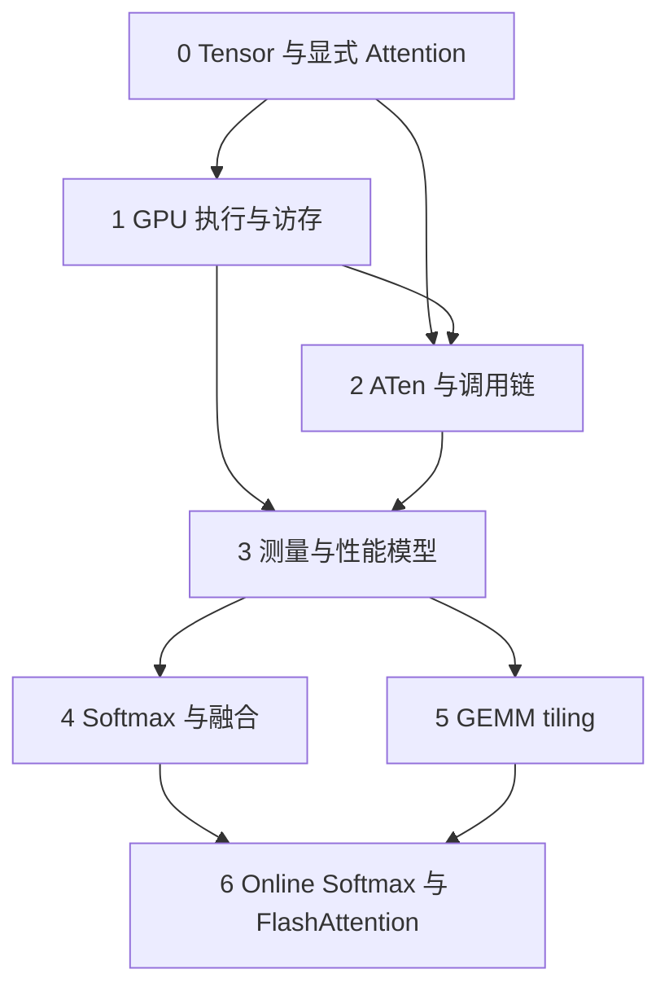
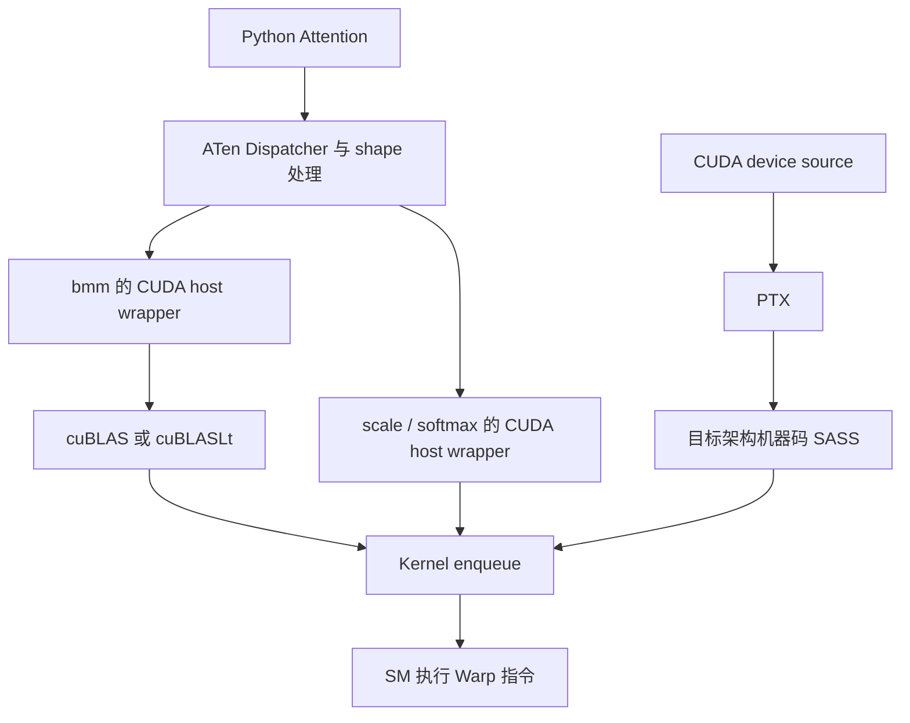

# 从 PyTorch Attention 到 GPU Kernel：最短有效学习路线

> [!warning]
> 本文包含 AI 生成或改写的实质内容，尚未完成人工核验。数学模型与 CPU 参考算法的验证范围见文末；GPU 实验尚未执行。

项目入口：[[10_Projects/attention-gpu-learning-lab/_Project - Attention GPU Learning Lab|Attention GPU Learning Lab]]。

以下实验命令默认在 `10_Projects/attention-gpu-learning-lab/` 目录执行。

核对日期：2026-11-02。本文是本项目的完整学习说明。目标是理解和分析 Kernel，而非完成大而全的 CUDA 课程。

## 1. 学习目标与最终能力边界

推荐主线：**显式 Attention → Tensor 布局与中间结果 → GPU 工作划分 → 调用/编译链 → 性能模型 → Reduction/Fusion 与 GEMM Tiling → Online Softmax/FlashAttention。**

完成后，应能独立：

1. 对一个 Attention forward 写出每步 Shape、Stride、存储 dtype、计算 dtype、FLOPs 和理想读写量。
2. 解释 Grid、Block、Warp、Thread 如何对应一段计算，以及数据可能停留在 register、shared memory、cache 或显存的哪个层次。
3. 从 PyTorch profiler 找到实际 ATen 操作和 GPU Kernel；沿源码追踪至 CUDA 实现或 cuBLAS 调用；对一个小 Kernel 识别 PTX/SASS 的 load、计算、store。
4. 用 CUDA Events、时间线和少量硬件计数器区分 launch、带宽、计算、资源/依赖瓶颈，并通过单变量实验验证假设。
5. 阅读 FlashAttention-1 的 forward 算法及 IO 分析，理解 FlashAttention-2 的工作划分；随后再为目标架构补充专属指令与流水线知识。

### 范围

第一轮固定单 GPU、dense、non-causal、forward-only、MHA，$d_v=d$；无 dropout、mask、QKV projection、autograd、torch.compile。不研究 KV-cache decode、GQA、MLA、稀疏 Attention、分布式通信或 backward。这是控制变量的教学选择，不代表这些内容不重要。

先用 FP32 小 Shape 看清语义，再用 FP16 测性能。正确性 reference 使用小 Shape 的 CPU FP64。FP16/BF16 输入、FP32 累加、FP16/BF16 输出是不同概念；真实 GEMM 的累加/归约策略仍要核对所用 backend 与设置。[S4] [S18]

如果使用 RTX 4070 Ti SUPER，它是 Ada / CC 8.9 / 16GB GDDR6X。本文通用称“显存/DRAM traffic”；在使用 HBM 的设备上才称 HBM traffic。它足够完成这里的基础实验，不需要先有 H100。Hopper 专属指令另学。[S17]

### 数学符号表

| 符号 | 含义 |
|---|---|
| $B,H,N,d$ | batch、head 数、query/key 序列长度、每 head 维度；本文 $d_v=d$ |
| $Q,K,V,O$ | 输入 query/key/value 与输出，各为 $[B,H,N,d]$ |
| $S,Z,P$ | 未缩放 scores、缩放 scores、softmax 概率，各为 $[B,H,N,N]$ |
| $i,j,t$ | query、key、特征维下标；使用时隐去 batch/head 下标 |
| $\sigma=d^{-1/2}$ | score scale |
| $s$ | 每个存储元素的字节数，本例 FP16 为 2 |
| $E=BHN^2$ | 全部 scores 的元素数 |
| $X=BHNds$ | 一个 Q/K/V/O 的存储字节数 |
| $A=BHN^2s$ | 一个 S/Z/P 的存储字节数 |
| $F,D,I=F/D$ | FLOPs、某存储层的传输字节、Arithmetic Intensity |
| $\Pi,\beta,T$ | 匹配执行路径的峰值算力、显存带宽、执行时间 |
| $B_M,B_N,B_K$ | GEMM query/output-row tile、key/output-column tile、归约维 tile |
| $T_Q=\lceil N/B_M\rceil$ | 每 head 的 query tile 数 |
| $m,\ell,u$ | 已扫描 scores 的最大值、缩放后分母、未归一化输出向量 |
| $\alpha,m',\ell',u'$ | 更新最大值时的重缩放系数，以及更新后的状态 |
| $z_{\mathrm{blk}},p_{\mathrm{blk}},V_{\mathrm{blk}}$ | 当前 key block 的 scaled scores、未归一化指数权重、values |
| $r_b,r_h,r_i,r_t$ | Tensor 各维以元素计的 stride |
| $\Pi_{\mathrm{TC}},\Pi_{\mathrm{scalar}},\Pi_{\exp}$ | 矩阵运算、常规标量运算、指数运算各自的吞吐能力 |

MiB = $2^{20}$ bytes；GFLOPs 使用 $10^9$；带宽 TB/s 使用 $10^{12}$ bytes/s。FMA 按 2 FLOPs 计。

## 2. 整体知识地图

建议预留约 25–35 小时的专注学习时间；这是安排预算，不是达标保证。按验收标准推进。

| 阶段 | 要回答的问题 | 必须深入 | 只需初步理解 | 最小产出 |
|---|---|---|---|---|
| 0. Tensor 与语义 | 这四行到底创建了什么？ | Shape、Stride、view、dtype、稳定 softmax | allocator 的大体职责 | 一张 Tensor 表 |
| 1. GPU 执行 | 同一个 scale 怎样分给线程？ | SM/Block/Warp、SIMT、coalescing、异步计时 | latency hiding、硬件资源限制 | 两个等价访存映射 |
| 2. 调用与编译 | 哪层决定调用哪个 Kernel？ | ATen/Dispatcher/backend 边界，PTX/SASS 区别 | codegen、库内算法选择 | 一张真实调用图 |
| 3. 性能分析 | 时间花在哪，理论下限是多少？ | FLOPs/bytes、cache 口径、分 Kernel 分析 | Nsight 指标分类 | 一份带假设的测量表 |
| 4. Softmax 与融合 | 如何少存、少搬一个大矩阵？ | row reduction、同步、FP32 状态、fusion | shuffle、shared-memory bank conflict | fused scale+softmax |
| 5. GEMM 与 Tile | 为什么读入一次能做很多乘加？ | tile 复用、资源预算、Tensor Core 矩阵指令概念 | fragment/layout、流水线概念 | 三种 tile 的对照 |
| 6. Online Attention | 不存完整 P 如何得到正确 O？ | running max/sum/output、重缩放、IO-aware schedule | FA2 工作划分；FA3/4 后续分支 | 数值验证 + SDPA 对照 |



**学习深度的优先级：**

- 必须真正会算、会画：Tensor 地址、Warp 地址集合、tile 数据复用、softmax 归约、累计流量与峰值占用、online 更新公式。
- 先能说清用途即可：PTX 指令类别、Tensor Core fragment、cache 层级、occupancy、stream 顺序。
- 暂时跳过：完整 CUDA ISA、GPU 电路/DRAM 时序、渲染管线、完整编译器、复杂 C++ 模板、完整 CUTLASS/CuTe、TMA/WGMMA、异步多级流水线、所有 attention backward。

## 3. 分阶段学习路线

### 阶段 0：Tensor 布局与数值语义

**目标：** 能从 Python 表达式画出数据流，不凭 API 名称猜复制。

**核心理论：** 连续 Q/K/V 的 stride 为 $(HNd,Nd,d,1)$。K 转置后 shape 为 $[B,H,d,N]$，stride 为 $(HNd,Nd,1,d)$，storage 没变。非 contiguous 不自动意味着低效；BLAS 可以理解很多转置布局。[S1]

**精读：** [Tensor Views][S1] 的 transpose、reshape、contiguous；[Numerical accuracy][S18] 的浮点非结合性。无需先读 allocator 源码。

**最小实验：**

```bash
python attention_lab.py tensors --device cuda --dtype fp32 --heads 2 --seq 128
python attention_lab.py check --device cuda --dtype fp16 --heads 2 --seq 128
```

没有 CUDA 时，这两个小语义实验可以 `--device cpu --dtype fp32` 运行。

**观察：** K 与转置共享 storage pointer；显式 contiguous copy 换了 storage。P 的最后一维和约为 1。Q/K/V/O 的元素数随 N 线性增长，S/Z/P 随 N 平方增长。不同浮点实现允许小误差。

**验收：** 手写每个 Tensor 的 shape/stride/字节数；解释为什么 K 转置不需要搬一遍数据、FP32 累加不等于 FP32 输出；能用 max-abs 和 relative-L2 而非 bitwise equality 做正确性判断。

`tensors` 模式为了展示会同时保留 S/Z/P；它的内存峰值不能用于后文“复用 scores 变量”的模型。

### 阶段 1：通过 scale 学 GPU 执行模型

**目标：** 看懂最小 CUDA Kernel 的线程映射与地址。

**先建立直觉：** Kernel 是许多逻辑线程运行的同一段程序；线程不是永久绑定某个 CUDA Core。普通 Block 在一个 SM 上执行；SM 可以同时容纳多个 Block。NVIDIA Warp 有 32 个线程，SM 的 Warp scheduler 在就绪 Warp 间发射指令。[S5] [S6]

| 层次 | 在本例中做什么 |
|---|---|
| Grid / Block / Warp / Thread | 组织并调度对 scores 的并行处理 |
| Registers | 每线程/协作片段的临时值、地址和累加器 |
| Shared memory | Block 内显式共享的 tile 或 reduction 中间结果 |
| L1 / L2 cache | 缓存命中的复用；不等同于 shared memory |
| DRAM（GDDR/HBM） | Q/K/V 和显式物化的 S/Z/P/O 的后备存储 |

Local memory 的“local”表示线程私有作用域，不保证片上；register spill 可能产生显存支持的 local-memory 访问。[S6]

**精读：** [Programming Model][S5] 的 Thread Hierarchy / Warps and SIMT；[Best Practices][S6] 的 Coalesced Access，之后才看 Occupancy。

**最小实验：**

```bash
nvcc -O3 -lineinfo -arch=sm_89 scale_cuda.cu -o scale_cuda
./scale_cuda 4096 50
```

`sm_89` 仅是 Ada 8.9 示例，请匹配实际 GPU。CUDA 文件只隔离同一 Attention 的 score scale，采用 FP32，以便直接用 4-byte float 解释访存。

两个 Kernel 都用 block=(32,8)：

- 好映射：lane 0..31 对应同一行的连续列。
- 坏映射：lane 0..31 对应同一列的相邻行。

**观察和原因：** FLOPs 与请求的逻辑字节相同，地址集合不同，内存事务利用率可能明显不同。对 CC≥6.0，32 个 lanes 读取连续且对齐的 32 个 float，覆盖 128B，常对应 4 个 32B transactions；不要说成“必然一次 128B 事务”。缓存复用意味着坏映射不必恰好慢固定倍数。[S6]

**验收：** 给定 row/col 公式，能算一个 Warp 的 32 个地址；说明 block/SM/warp/硬件执行单元不是一一映射；解释为什么计时要等 GPU 完成。

### 阶段 2：分开运行时调用链与设备代码编译链

**目标：** 从 profiler 到源码建立对应，而不编译整个 PyTorch。

**必须理解的边界：**

1. Python API 是入口。
2. Dispatcher 按 Dispatch Keys 选择实现；ATen native 可继续分解/处理 shape。
3. CUDA host wrapper 设置参数，并调用库或 launch 自有 Kernel。
4. 设备侧机器码才由 SM 执行。
5. PTX/SASS 是编译与装载层次，不是每次 Python 调用都现场经过的一串翻译步骤。[S7] [S8]

固定教学源码为 **PyTorch v2.5.1**，无需安装此旧版本。实际追踪应对照 `torch.version.git_version`，避免用 main 猜当前安装包。

| 入口 | 精读源码和符号 |
|---|---|
| 四维 matmul 如何折叠 batch | [LinearAlgebra.cpp][C1]：`_matmul_impl` |
| bmm 如何调用 CUDA BLAS | [cuda/Blas.cpp][C2]：`bmm_out_cuda`、`baddbmm_out_cuda_impl`、`prepare_batch_matrix_for_cublas` |
| CUDA BLAS wrapper | [cuda/CUDABlas.cpp][C3]：`bgemm_internal` 及 cuBLAS/cuBLASLt 调用 |
| elementwise scale | [BinaryMulKernel.cu][C4]：`mul_kernel_cuda` |
| 最后一维 softmax | [SoftMax.cu][C5]：`softmax_cuda_out`、`host_softmax` |

`host_softmax` 是选择/发射 CUDA Kernel 的主机包装，不表示在 CPU 上计算整个 softmax。不同长度/布局可能选择不同 softmax Kernel；不能保证所有情况只读一次输入。

**最小实验：**

```bash
python attention_lab.py profile --device cuda --dtype fp16 --heads 8 --seq 1024
cuobjdump --dump-sass ./scale_cuda
nvcc -O3 -arch=compute_89 -ptx scale_cuda.cu -o scale_cuda.ptx
```

阅读 [CUDA Binary Utilities][S7] 中 dump SASS/PTX 的小节和 [NVCC Guide][S8] 中 compilation phases。

**观察：** transpose 可能只有 CPU metadata 操作；matmul 可能进一步出现 bmm；一个库调用可能有多个 Kernel。预期找到 QK、scale、softmax、PV 对应的工作，但实际 kernel 数以 trace 为准。在自己的 scale PTX/SASS 中寻找 load、mul、store 和地址计算，不从 cuBLAS 的巨型反汇编入门。

**验收：** 手画一条已被 trace 和源码支持的调用链；说清 Python/ATen/Kernel 并非一一对应，PTX 是虚拟 ISA、SASS 面向具体架构，二进制可预编译或在需要时 JIT。

### 阶段 3：建立可靠测量与性能模型

**目标：** 对一个性能现象提出可证伪的解释。

**精读：** [CUDA semantics][S2] 的 Asynchronous execution；[PyTorch Profiler recipe][S3]；[Nsight Compute Profiling Guide][S9] 的 MemoryWorkloadAnalysis、LaunchStats、Occupancy、Roofline。不要先看全部 stall counters。

**最小实验：**

```bash
python attention_lab.py bench --device cuda --dtype fp16 --heads 8 --seq 1024
python attention_lab.py sweep --device cuda --dtype fp16 --heads 8
```

扫描 N=512/1024/2048/4096。计时在 profiler 外；先 warmup，剔除 Triton JIT；多次重复报告中位数。脚本记录“CUDA Events 时间”和“同步后 wall time”，未同步 Python 时间只反映主机提交的一部分。

| 工具 | 优先回答的问题 |
|---|---|
| PyTorch Profiler | 哪个 ATen 操作占时，关联哪些 GPU Kernel？ |
| Nsight Systems | CPU/GPU 时间线、launch 间隙、拷贝和 stream 顺序是什么？ |
| Nsight Compute | 目标 Kernel 的 DRAM/L2 访问、矩阵管线、资源限制是什么？ |

例：`nsys profile --trace=cuda,nvtx -o attention_run python attention_lab.py bench --device cuda --dtype fp16 --heads 8 --seq 1024`。已有 trace 能回答问题时，不必为完整性重复采全部工具。

在 scale 独立程序中，可以先以 `ncu --set basic ./scale_cuda 4096 5` 认识报告，再选择目标 Kernel 的 MemoryWorkloadAnalysis。不要把带 replay 的 ncu 运行耗时作为正常 benchmark；counter 权限不可用时先保留 event/trace 实验。

**观察：**

- N 翻倍，主计算和显式 score 存储约变四倍，但小 Shape 会受到 launch、tile/wave 效率等影响，耗时不必精确四倍。
- `max_memory_allocated` 是峰值活跃分配，不是累计流量；`memory_reserved` 是 allocator 保留空间，不是当前张量大小。
- 高 nvidia-smi 利用率不能证明 Tensor Core 饱和。高 occupancy 也不必更快，资源分配与数据复用可能存在权衡。[S6] [S9]
- Events 包围循环仍可能包含 GPU 等待主机后续提交的空隙；非常小的算子应结合时间线解释。

**验收：** 完成第 5 节的手算，并用“预测→测量→不符时查缓存/实际实现/资源/计时口径”的顺序解释一个现象。测量表至少保存 GPU/CC、Torch/CUDA/Triton 版本、Shape、dtype、median、误差、峰值额外分配和 backend。

### 阶段 4：Row Softmax、Reduction 与 Kernel Fusion

**目标：** 理解一行数据如何合作归约，以及 fusion 为什么省 IO。

**核心概念：** 稳定 softmax 的 max、exp、sum；Warp/Block reduction；合法同步；FP32 内部状态；片上容量；寄存器压力。先理解各步骤，再学习 shuffle / shared-memory tree 的两种通信方法。Shared memory bank conflict 先只要求知道“不同线程的访问布局会影响并行度”；具体优化后置。

**精读：** [Triton Fused Softmax][S10] 的 kernel 与内存流量解释。教程将手写 max/exp/sum 拆开作为 naive 对照；它的多 pass 读写数字不能直接套给已经融合的 `torch.softmax`。

**最小实验：**

```bash
python triton_softmax.py --n 1024 --warps 4
python triton_softmax.py --n 1031 --warps 8
python triton_softmax.py --d 80
```

仍处理同一个 QK 产生的 score matrix，展平为 `[BH*N,N]`。只把 `scale + softmax` 合成一行一个 program 的 Triton Kernel；QK 不计入这次计时。

**观察和原因：** 理想逻辑流量由“读 S、写 Z、读 Z、写 P”的 $4A$ 变为“读 S、写 P”的 $2A$。减少了一次完整矩阵读写和一次 launch，但不保证所有 Shape 都加速。N=1031 需要 mask；4/8 warps 会改变并行度和资源消耗。Triton program 不等于线程，逻辑 arange 不直接指定 lane。

FP16 eager 会存储缩放后的 Z，fused 版本可以保留 FP32 Z，舍入位置不同。默认 d=64 的 scale=1/8 是二进制精确缩放（除范围等影响外）；d=80 更容易展示这一数值差别。

**验收：** 能说明 reduction 通信范围，解释每个 mask 的用途，写出融合前后的字节账，并承认与高精度 reference 接近比逐位相同更合适。

### 阶段 5：GEMM Tiling 与 Tensor Core

**目标：** 读懂 QK/PV 的 tile，而不从零写一个 cuBLAS 级 GEMM。

**直觉：** 一个 Q tile 的元素可与多个 key 组合，一个 K tile 的元素可被多个 query 使用。数据复用让“每搬一个字节所做的计算”增加。

对一次归约 tile：

$$
[B_M,B_K]\times[B_K,B_N]\to[B_M,B_N]
$$

$$
F_{\mathrm{tile}}=2B_MB_NB_K,\qquad
D_{\mathrm{tile,inputs}}=sB_K(B_M+B_N).
$$

只计当前 tile 输入、不计输出写回、cache 与跨 tile 复用：

$$
I_{\mathrm{tile,inputs}}=\frac{2B_MB_N}{s(B_M+B_N)}.
$$

例如 $B_M=B_N=B_K=64,s=2$ 时为 32 FLOPs/byte。这是“单 tile 输入复用”模型，不能误当全 Kernel 的实际 DRAM AI。

Tensor Core 提供矩阵乘加指令；同一个 Kernel 中还包含普通 SIMT 的索引、load/store、reduction 等。FP16 只提供使用 Tensor Core 的条件之一，真实路径要看 shape/layout/backend/硬件与 profiler。[S11]

**精读：** [Triton Matrix Multiplication][S12] 的 Block-level matrix multiplication、Pointer Arithmetic；[NVIDIA Matrix Multiplication Background][S11] 的 Math and Memory Bounds / GPU Implementation。Autotune 和高级 L2 swizzle 先跳过。

**最小实验：**

```bash
python triton_qk.py --n 1024
python triton_qk.py --n 1031 --block-m 64
```

只算同一个 Attention 的 QK；固定 BN=64、BK=32、4 warps，比较 BM=32/64/128。使用 FP32 accumulator，写出 FP16 S，与 PyTorch GEMM 对照。

**观察和原因：** tile 变大可能增加复用，但也提高 registers/shared memory 需求，减少驻留 CTA 或改变 wave 数，性能未必单调。N 非整除时有 padding/mask 的工作效率损失。先固定单一变量，不要同时开始 autotuning。

**验收：** 给一块 S，能指出对应 Q/K 的区域和归约维；能列出 Q/K tile、score/output accumulator 的容量需求；能解释 occupancy 与 reuse 的权衡，而不把整张 GPU 的总 SRAM 当成一个 Block 可用空间。

### 阶段 6：Online Softmax 与 FlashAttention

**目标：** 从数学上证明无需完整 P，再理解如何把分块计算留在片上。

**精读顺序：**

1. [FlashAttention-1][S13] §2、§3.1（tiling / online softmax）、§3.2（IO）。先跳 backward 和复杂扩展。
2. [FlashAttention-2 作者博客][S14] 的 fewer non-matmul FLOPs / better parallelism / work partitioning，再读论文 §3。
3. [Triton Fused Attention][S15] 的 forward 核心。当前教程还含架构特化路径，第一次仅跟普通 forward 的数据流和统计量，不要求读完全部分支。

**直觉和公式：** 每次读一块 K/V，不保留历史所有概率，只保留“历史最大值、归一化分母、加权输出”。当最大值变大，要同步重缩放历史分母和分子。

对一条 query，已读 keys 的状态为：

$$
m=\max_j z_j,\qquad
\ell=\sum_j e^{z_j-m},\qquad
u=\sum_j e^{z_j-m}v_j.
$$

读入新 block 后：

$$
m'=\max(m,\max z_{\mathrm{blk}}),\qquad
\alpha=e^{m-m'},\qquad
p_{\mathrm{blk}}=e^{z_{\mathrm{blk}}-m'}.
$$

$$
\ell'=\alpha\ell+\sum p_{\mathrm{blk}},\qquad
u'=\alpha u+p_{\mathrm{blk}}V_{\mathrm{blk}},\qquad
o=u/\ell\quad\text{（所有 blocks 结束后）}.
$$

初值 $m=-\infty,\ell=0,u=0$。这里固定 non-causal、无全遮蔽行；以后加入 mask 要单独处理全为 $-\infty$ 的情况。

小例子：scores 为 $[0,\log2,\log4]$。先读前两项，则 $m=\log2,\ell=1.5,u=0.5v_1+v_2$。新块的最大值为 $\log4$，所以 $\alpha=0.5$；更新后 $\ell'=1.75,u'=0.25v_1+0.5v_2+v_3$，最终输出是 $(v_1+2v_2+4v_3)/7$，与完整 softmax 相同。

**最小实验：**

```bash
python attention_lab.py online --device cpu --seq 129
python attention_lab.py sdpa --device cuda --dtype fp16 --heads 8 --seq 4096
```

第一个是 FP64 分块 reference，测试不同 tile 大小和尾块；Python 分块循环是数学教学，不是高性能 FlashAttention。第二个在同一输入上比较 eager、强制 SDPA MATH、强制 FLASH_ATTENTION；不支持的 backend 会明确报告，不静默改用其他实现。

**观察：** 融合实现可避免完整 $N^2$ S/P 的落盘，但仍完成全部 dense Attention 主项计算。不同 backend 的舍入顺序可导致微小数值差别。SDPA MATH 对 FP16/BF16 输入的中间结果使用 float，不能套用手写 FP16 eager 的全部内存数字；FLASH_ATTENTION 枚举也不直接代表外部 flash-attn 包的某个版本。[S4]

**验收：** 不看代码写出上面的四个更新步骤并解释 alpha；说清不存 N² 不意味着 dense 计算变线性，也不保证 DRAM 总流量严格线性；从 forward 源码中找到 query tile、K/V loop、online 状态和最终 O store。

**后续架构分支：** FA2 再深入 Block/Warp 工作划分；读 FA3 前补 Hopper 的 WGMMA/TMA 和异步流水线；官方仓库当前还有 CuTeDSL 实现的 FA4，针对 Hopper/Blackwell，选定该版本时再补对应知识。无需把后续分支全部塞进前置课程。[S16] [S19]

## 4. Attention 贯穿案例：同一计算，逐层改变观察方式

### 4.1 唯一数学对象

$$
S=QK^\top,\quad Z=S/\sqrt d,\quad
P=\operatorname{softmax}(Z,\text{last dim}),\quad O=PV.
$$

单 head 的分量形式：

$$
S_{ij}=\sum_{t=0}^{d-1}Q_{it}K_{jt},
\qquad O_{it}=\sum_{j=0}^{N-1}P_{ij}V_{jt}.
$$

先想象：一条 query 读取全部 keys，为每个 key 生成权重，再加权读出 values。

### 4.2 显式 baseline

```python
import torch

@torch.inference_mode()
def attention_eager(q, k, v):
    scores = q @ k.transpose(-2, -1)
    scores = scores * (q.shape[-1] ** -0.5)
    probs = torch.softmax(scores, dim=-1)
    del scores
    return probs @ v
```

| 对象 | Shape | 连续布局或转置后的 stride | 生命周期提示 |
|---|---|---|---|
| Q/K/V | [B,H,N,d] | (HNd,Nd,d,1) | 全 forward 保留 |
| Kᵀ view | [B,H,d,N] | (HNd,Nd,1,d) | 与 K 共享 storage |
| S/Z/P | [B,H,N,N] | 通常 (HN²,N²,N,1) | 不同阶段可释放旧 buffer |
| O | [B,H,N,d] | 通常 (HNd,Nd,d,1) | 最终输出 |

一般地址公式（stride 以元素计）：

$$
\operatorname{addr}(Q_{bhit})
=\operatorname{base}
+s\bigl(\operatorname{storage\_offset}
+br_b+hr_h+ir_i+tr_t\bigr).
$$

第一天手算地址，第二阶段把一个 Warp 的 32 次访问代入该式，第五阶段把一块 tile 的地址代入同一公式。

### 4.3 运行时路径与编译路径



图中编译分支表示设备代码的来源；实际分发包常已带 cubin，驱动也可在需要时从 PTX JIT。它不是每次调用都重新执行的路径。[S7] [S8]

### 4.4 每轮只增加一个问题

| 轮次 | 保持不变 | 新增观察 |
|---|---|---|
| 语义 | 相同 attention 公式 | Shape/Stride/输出 |
| eager trace | 相同输入与数学 | ATen / launch / kernels |
| scale | 隔离 score 的同一子操作 | Warp 地址集合 |
| softmax fusion | 同一 score 输入 | 消除 Z buffer 与一趟读写 |
| tiled QK | 同一 QK 算式 | tile 复用、资源预算 |
| online reference | 完整 attention 数学 | 不显式保存 P 的递推 |
| SDPA fused | 同一输入/目标数学 | 实际 backend、内存与耗时 |

## 5. 性能分析入门示例

### 5.1 明确假设

- $B=1,H=8,N=4096,d=d_v=64$，单 GPU dense non-causal forward。
- Q/K/V/O 和显式 S/Z/P 采用 FP16 storage，$s=2$；softmax 内部归约按 FP32 理解。
- 没有 autograd/dropout/mask/projections/torch.compile；不是 SDPA MATH 的中间 FP32 模型。
- GEMM 按 $2MNK$ 计，暂只将两次 GEMM 的 FLOPs 作为主项。
- 先假设每个高层操作的输入读一次、输出写一次，softmax 归约在片上完成。
- 为把此理想逻辑 IO 估为 HBM/DRAM IO，进一步假设数据经过目标显存层、不跨 Kernel 保持 cache 复用；忽略 tile 重读、spill、workspace、allocator rounding、额外 passes。
- **这些是假设，不是测量结果。** 真正 DRAM 字节必须用硬件计数器核对；warm cache 可使其更小，重读等可使其更大。

### 5.2 FLOPs

QK 每个 head 的形状是 $[N,d]\times[d,N]$：

$$
F_{QK}=2BHN^2d=17.179869184\ \mathrm{GFLOPs}.
$$

PV 为 $[N,N]\times[N,d]$，相同：

$$
F_{PV}=2BHN^2d,\qquad
F_{\mathrm{GEMM,total}}=4BHN^2d=34.359738368\ \mathrm{GFLOPs}.
$$

Scale 另有 $E=BHN^2=134{,}217{,}728$ 次乘法，约 0.1342 GFLOPs。

Softmax 另有约 $E$ 次减法、$BHN(N-1)$ 次求和加法、$E$ 次归一化运算、$E$ 次 exp 和 $BHN(N-1)$ 次比较。不能将 exp/reduction 时间直接除以 Tensor Core 峰值；它们竞争不同执行资源。

### 5.3 Tensor 占用与生命周期

$$
X=BHNds=4\ \mathrm{MiB},\qquad
A=BHN^2s=256\ \mathrm{MiB}.
$$

Q/K/V/O 合计 16 MiB。每一个完整 S/Z/P 都是 256 MiB，但三个名字不意味着三个 buffer 必须全程同时存活。

对本例复用 scores 变量并在 softmax 后删除 scores 的实现：

$$
\operatorname{peak}_{\mathrm{live\ tensors}}\approx 2A+3X=524\ \mathrm{MiB}.
$$

输入 Q/K/V 已分配后，增量峰值约 512 MiB。若调试代码同时保存 S、Z、P，峰值会变；训练 backward 保存激活也会变。workspace 和 allocator 行为可使实测不同。

### 5.4 按操作列 Read/Write

| 操作 | 理想读取 | 理想写入 | 合计 |
|---|---:|---:|---:|
| QK → S | 2X | A | 264 MiB |
| S → Z，scale | A | A | 512 MiB |
| Z → P，softmax | A | A | 512 MiB |
| P,V → O | A+X | X | 264 MiB |
| 总计 | — | — | **1552 MiB** |

$$
D_{\mathrm{eager}}=6A+4X
=1{,}627{,}389{,}952\ \mathrm{bytes}
=1.515625\ \mathrm{GiB}.
$$

因此 **524 MiB 峰值占用与 1552 MiB 累计传输是两种不同量**。不能通过 torch.cuda 内存分配统计得到实际 HBM read/write。

### 5.5 Arithmetic Intensity

以两次 GEMM 主项表示：

$$
I_{\mathrm{eager}}\approx
\frac{4BHN^2d}{6BHN^2s+4BHNds}
=\frac{4Nd}{s(6N+4d)}
\approx21.11\ \mathrm{FLOPs/byte}.
$$

分别看子操作：

- 单 GEMM 的理想 AI 约为 62.06 FLOPs/byte。
- scale 的 AI 为 $E/(2Es)=1/(2s)=0.25$ FLOPs/byte。
- softmax 的普通算术、指数和 reduction 要按对应管线单独分析。

整个 Attention 的平均 AI 不能代替每个 Kernel 的瓶颈分析。

### 5.6 执行时间下界

使用**纯教学虚拟硬件**：dense FP16 GEMM 峰值 $\Pi_{\mathrm{TC}}=100$ TFLOP/s，DRAM 带宽 $\beta=1$ TB/s。不对应你的具体 GPU，也不采用稀疏/FP8 的 AI TOPS。

两资源粗下界：

$$
T_{\min}\ge
\max\left(
\frac{F_{\mathrm{GEMM,total}}}{\Pi_{\mathrm{TC}}},
\frac{D_{\mathrm{DRAM}}}{\beta}
\right).
$$

将假设模型的 $D_{\mathrm{eager}}$ 代入：

$$
T_{\mathrm{compute}}\approx0.3436\ \mathrm{ms},\quad
T_{\mathrm{memory}}\approx1.6274\ \mathrm{ms},
\quad T_{\min}\ge1.6274\ \mathrm{ms}.
$$

按顺序 Kernel 分析更有用：

| 阶段 | GEMM 算力下界 | 带宽下界 | 当前可知下界 |
|---|---:|---:|---:|
| QK | 0.1718 ms | 0.2768 ms | 0.2768 ms |
| scale | 不使用 Tensor Core 峰值 | 0.5369 ms | ≥0.5369 ms |
| softmax | 不使用 Tensor Core 峰值 | 0.5369 ms | ≥0.5369 ms |
| PV | 0.1718 ms | 0.2768 ms | 0.2768 ms |

本例相加仍是 1.6274 ms，因为在这个简化模型中，已知最强限制都来自带宽。一般应对每个顺序 Kernel，分别考虑 Tensor Core、scalar、exp、DRAM 等资源，再将各 Kernel 的下界相加。Launch、依赖、同步、低资源利用会再增加时间。Roofline 提供乐观上界/下界约束，不是精确 runtime 预言。[S9]

### 5.7 实现变化怎样改变模型

**第一步：融合 scale。**

不再额外读写完整 Z 后：

$$
D_{\mathrm{scale\ fused}}=4A+4X=1040\ \mathrm{MiB},
\qquad I\approx31.51\ \mathrm{FLOPs/byte}.
$$

`scores.mul_(scale)` 只改变 storage 生命周期，仍需执行一趟读写；真正移除 $2A$ 流量需要把 scale 融进生产者或消费者 Kernel。

**第二步：分块 online Attention。**

先建立一个 FA2 风格的 **Q tile 驻留、遍历 K/V** 教学 schedule。令 $B_M=128,T_Q=32$。每个 query tile 读取一次 Q、保持输出累加器、扫描全部 K/V、最终写 O。假设不同 query tiles 之间没有 cache 复用：

$$
D_{\mathrm{tiled}}\approx2X+2T_QX=264\ \mathrm{MiB}.
$$

$$
I_{\mathrm{tiled}}\approx124.12\ \mathrm{FLOPs/byte},\qquad
T_{\min}\ge\max(0.3436,0.2768)=0.3436\ \mathrm{ms}.
$$

这解释了“减少 IO 后可能转向计算瓶颈”，但不保证实现达到这个时间。

| 实现模型 | 理想流量 | 主项 AI | 说明 |
|---|---:|---:|---|
| 显式 eager | 1552 MiB | 21.11 | 独立 scale + softmax |
| scale 融合 | 1040 MiB | 31.51 | 仍显式存完整 P |
| Q tile 驻留，BM=128 | 264 MiB | 124.12 | 无跨 query tile cache 复用 |
| Q/K/V 各读一次，O 写一次 | 16 MiB | 2048 | 仅 cold compulsory IO 理想下限 |

最后一行 **不是实际 FlashAttention 流量**。有限片上资源导致 K/V 或 Q/O/统计量重复访问，cache 决定哪些 global loads 触及 DRAM。FA1 原论文的 Algorithm 1 外层遍历 K/V，不能与上述 Q 驻留循环混为一谈。消除 N² 额外存储不意味着 DRAM 流量严格线性；dense FLOPs 的 $N^2$ 主项仍然存在。[S13] [S14]

## 6. FlashAttention 前置知识检查清单

满足以下前六项即可开始 FA1；第七项通过后再深入 FA2：

- [ ] 不运行代码就能写出 Q/K/V、S/P/O 的 shape、stride、字节数。
- [ ] 能区分 Thread、Warp、Block、SM，并根据索引算出 Warp 的访问地址。
- [ ] 能解释寄存器、shared memory、L1/L2、DRAM 的用途；知道 local memory/spill 的含义。
- [ ] 能从 profiler 找到 QK/scale/softmax/PV 的实际 GPU 工作，分清调用链与编译链。
- [ ] 能独立算出本例 34.36 GFLOPs、256 MiB 的单个 score、1552 MiB 的理想流量，并说清模型假设。
- [ ] 能推导 running max/sum/output 的重缩放，且小规模分块实现通过高精度 reference。
- [ ] 能解释 tile 复用、register/shared-memory 压力、occupancy、CTA/Warp 工作划分之间的权衡。

不需要先学会手写 PTX、高性能 GEMM、完整 CUTLASS 模板或全部 Hopper 指令。若无法解释 online update，就先停在数学实验；若公式已懂但 tile/资源预算不清，就回到阶段 5。

## 7. 建议的第一步：第一天约 90–120 分钟

**阅读 20–30 分钟：**

- Tensor Views 的 transpose/contiguous。
- CUDA semantics 的 Asynchronous execution。
- CUDA Programming Model 的 Thread Hierarchy，仅建立层级直觉。

**运行 30–40 分钟：**

```bash
python attention_lab.py tensors --device cuda --dtype fp32 --heads 2 --seq 128
python attention_lab.py check --device cuda --dtype fp16 --heads 2 --seq 128
python attention_lab.py profile --device cuda --dtype fp16 --heads 8 --seq 1024
python attention_lab.py bench --device cuda --dtype fp16 --heads 8 --seq 1024
```

**记录 20–30 分钟：**

1. K 和 Kᵀ 是否共享 storage？各自 stride 是多少？
2. 哪个 Tensor 随 N² 增长？单个 score matrix 何时成为主要内存项？
3. 这次环境实际出现哪些 ATen 操作和 GPU Kernel？是否看到单独 scale？
4. 未同步主机提交时间与 GPU 完成时间有什么差别？
5. 当前证据能说明什么，哪些只是猜测？今天不要求解释每条底层指令。

第一天的产出只需一页实验记录。第二天在同一个 scale 子操作上开始 CUDA 线程/地址映射。

## 实验包内容与验证边界

| 文件 | 用途 |
|---|---|
| attention_lab.py | 布局、正确性、计时、profiler、长度扫描、online reference、SDPA backend 对照 |
| scale_cuda.cu | 原生 CUDA score scale 的两种访存映射；PTX/SASS 入门 |
| triton_softmax.py | 同一 QK score 的 scale + row softmax fusion |
| triton_qk.py | 同一 QK 的最小 tiled GEMM，比较 BM=32/64/128 |
| verify_models.py | CPU NumPy 验证流量数字与 online 递推 |
| cpu_model_check.json | 本次 CPU 模型验证结果 |

环境前提：已可用的 CUDA PyTorch；原生 CUDA 实验另需匹配 GPU 的 CUDA Toolkit/nvcc；Triton 实验使用与已有环境兼容的 Triton。不要为路线无条件升级所有组件。

本次交付环境没有 PyTorch、Triton、nvcc 或可用的 NVIDIA GPU 执行工具，因此 **GPU 实验没有编译/运行，也没有实测加速数据**。已验证：全部 Python 文件语法；CPU NumPy 的 12 组非整除 tile 递推，最大绝对误差约 $5.55\times10^{-16}$；数值账；CUDA 两种索引映射在多个小尺寸完整、无重复覆盖。脚本中的 GPU assert/计时用于在实际设备验证。

这些是理解原理的最小教学实现，未覆盖任意输入的健壮性或工业性能；固定随机种子、具体 tolerance 与小尺寸范围在代码中注明。

## 参考资料

[S1]: https://docs.pytorch.org/docs/2.15/tensor_view.html
[S2]: https://docs.pytorch.org/docs/2.15/notes/cuda.html#asynchronous-execution
[S3]: https://docs.pytorch.org/tutorials/recipes/recipes/profiler_recipe.html
[S4]: https://docs.pytorch.org/docs/2.15/generated/torch.nn.functional.scaled_dot_product_attention.html
[S5]: https://docs.nvidia.com/cuda/cuda-programming-guide/01-introduction/programming-model.html
[S6]: https://docs.nvidia.com/cuda/archive/13.0.1/cuda-c-best-practices-guide/index.html
[S7]: https://docs.nvidia.com/cuda/cuda-binary-utilities/index.html
[S8]: https://docs.nvidia.com/cuda/cuda-compiler-driver-nvcc/index.html
[S9]: https://docs.nvidia.com/nsight-compute/ProfilingGuide/index.html
[S10]: https://triton-lang.org/main/getting-started/tutorials/02-fused-softmax.html
[S11]: https://docs.nvidia.com/deeplearning/performance/dl-performance-matrix-multiplication/index.html
[S12]: https://triton-lang.org/main/getting-started/tutorials/03-matrix-multiplication.html
[S13]: https://arxiv.org/pdf/2205.14135
[S14]: https://crfm.stanford.edu/2023/07/17/flash2.html
[S15]: https://triton-lang.org/main/getting-started/tutorials/06-fused-attention.html
[S16]: https://tridao.me/blog/2024/flash3/
[S17]: https://www.nvidia.com/en-sg/geforce/graphics-cards/40-series/rtx-4070-family/
[S18]: https://docs.pytorch.org/docs/2.15/notes/numerical_accuracy.html
[S19]: https://github.com/Dao-AILab/flash-attention
[C1]: https://github.com/pytorch/pytorch/blob/v2.5.1/aten/src/ATen/native/LinearAlgebra.cpp
[C2]: https://github.com/pytorch/pytorch/blob/v2.5.1/aten/src/ATen/native/cuda/Blas.cpp
[C3]: https://github.com/pytorch/pytorch/blob/v2.5.1/aten/src/ATen/cuda/CUDABlas.cpp
[C4]: https://github.com/pytorch/pytorch/blob/v2.5.1/aten/src/ATen/native/cuda/BinaryMulKernel.cu
[C5]: https://github.com/pytorch/pytorch/blob/v2.5.1/aten/src/ATen/native/cuda/SoftMax.cu

[FA2 论文](https://tridao.me/publications/flash2/flash2.pdf)
[Online normalizer 原论文](https://arxiv.org/abs/1805.02867)
[Nsight Systems](https://docs.nvidia.com/nsight-systems/UserGuide/index.html)
