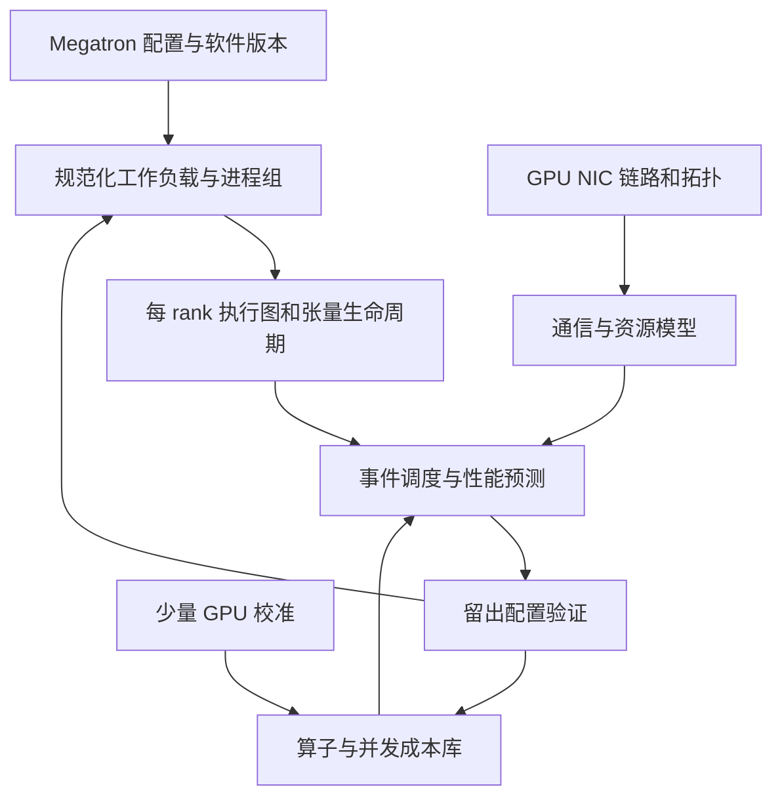

# 大规模 LLM 训练性能建模与仿真技术调研

> [!warning]
> 本文包含 AI 生成或改写的技术调研，尚未完成人工核验；论文实验、当前项目功能与工程推导分别标注。

校准与调试相关笔记：[[LLM AI-Infra Profiling 技术体系调研]]、[[megatron_lm_profiling_debug_guide|Megatron-LM Profiling & Debug 实践指南]]。

**资料截止：2026 年 11 月 5 日。主要场景：Megatron-LM / Megatron-Core 的 Dense 与 MoE 训练。**

本报告围绕训练迭代时间、吞吐、显存可行性、并行策略和网络拓扑展开。结论依据公开论文、官方文档与源码核查；下文的验证实验是建议方案，未在本次调研中执行。标为“论文结果”的数字属于原作者实验，“当前实现”以公开代码及文档为准，“工程推导”用于说明机制和设计方案。

## 1 Executive Summary

**可以在不部署目标规模 GPU 集群的条件下预测训练性能。最实用的办法是用少量目标 GPU 校准算子和通信成本，再用执行依赖图与资源模型推演完整集群。** 已有研究在指定模型、软件栈和拓扑上实现个位数百分比的误差；跨硬件外推、动态 MoE、复杂通信重叠和现代 pipeline schedule 的可靠性取决于额外校准与适配。

本领域已经形成三个具有工程价值的方向：

1. **分析模型与实测数据库结合。** Calculon 提供较早的 Transformer 系统协同设计分析框架；SimuMax、ScalePlan 把模型、并行策略和硬件配置组织为可搜索的输入，适合容量规划与候选筛选。
2. **执行图与网络联合仿真。** ASTRA-sim / Chakra 提供可组合的仿真基础设施；SimAI / AICB / SimCCL 更贴近训练框架和 NCCL 行为，适合研究大规模通信与拓扑。
3. **复用真实框架执行语义。** Echo 的 ex-situ tracing、Phantora 的运行时拦截，以及 Charon 的编译器式图变换，分别降低工作负载构造、框架行为维护和多种优化组合的建模成本。[R1] [R4] [R7] [R11] [R14] [R17]

对你的 Megatron 工程环境，建议先建立 **SimuMax 加小规模真机验证** 的基线，再接入 **AICB / SimAI 的通信和拓扑分析**。当需要长期维护新的 CP、pipeline 或 MoE 行为时，再投入 **STAGE / Chakra / ASTRA-sim 的前端适配与事件模型**。Phantora 值得做一个独立兼容性验证，用来评估直接复用你现有 Megatron 代码的成本。

需要特别记住四个结论：

- **Step time 是受资源约束的执行图完成时间。** FLOPs、通信字节数和峰值硬件规格只给出部分约束。
- **重叠需要同时建模依赖、资源共享和相互减速。** 图上同时开始的两个任务不一定能保持各自独立运行时的速度。
- **“能表达”与“已支持”是不同层次。** ASTRA-sim 能执行一个包含 CP 通信的图，不代表它自动理解任意 Megatron CP 配置；AICB 存在 CP 参数，也不代表生成链路完整。
- **精度必须附带实验范围。** SimAI 的 1,024-GPU 端到端验证、Multiverse 的 54,000-GPU 仿真规模、SimuMax 的缩层模型验证，以及 Charon 的单个显存实验，是四类不同证据。[R4] [R6] [R9] [R17]

## 2 数学符号表

除特别说明外，时间用秒，容量和数据量用字节，带宽用字节每秒；GB 与 GiB、Gb/s 与 GB/s 在输入中分别记录。

| 符号 | 含义 |
|---|---|
| $N$ | 训练总 GPU 数 |
| $d_t,d_p,d_d,d_c,d_e,d_{et}$ | TP、PP、DP、CP、EP、Expert TP 的并行度 |
| $d_{ed}$ | Expert DP 的并行度，以实际 expert process group 为准 |
| $B_g,b,m$ | 全局 batch、每个 DP replica 的 micro-batch size、每步 micro-batch 数 |
| $S,H,L$ | 序列长度、hidden size、Transformer 层数 |
| $P,P_{\rm active}$ | 模型总参数量、每 token 参与计算的参数量 |
| $P_r,d_s$ | rank 上属于同一 optimizer 分片组的本地参数量、该组大小 |
| $F_i,Q_i$ | 操作 $i$ 的 FLOPs、在所建模存储层级产生的实际数据流量 |
| $\Pi_{\rm peak},\Pi_{\rm eff}$ | 峰值与有效计算吞吐，FLOP/s |
| $W_{\rm HBM},W_{\rm net}$ | 有效 HBM 带宽与网络带宽 |
| $\eta_i,\ell_i$ | 算子效率系数、单独建模的固定开销 |
| $G=(V,E)$ | 操作节点及依赖边组成的有向图 |
| $s_i,f_i,\tau_i$ | 操作开始时间、完成时间、执行时长 |
| $a_i,\operatorname{pred}(i)$ | 资源允许操作开始的时刻、操作的前驱集合 |
| $T_{\rm step},X_{\rm tok}$ | 训练迭代时间、token 吞吐 |
| $F_{\rm model},F_{\rm executed}$ | 整个集群一次迭代的有效模型 FLOPs、含重算等额外工作后的执行 FLOPs |
| $q,D,\alpha$ | collective 的 rank 数、每 rank 的输入数据量、每轮通信启动延迟 |
| $t_f,t_b$ | 一个 PP stage 处理一个微批的前向、反向时间 |
| $\beta_{\rm bubble}$ | 流水线空泡在简化迭代时间中的占比 |
| $M_r(t),M_{\rm peak}$ | rank 显存随时间的占用、全 rank 的最大峰值 |
| $\mathcal A_r(t)$ | 时刻 $t$ 在 rank $r$ 上仍存活的 activation 集合 |
| $M_{\rm state},M_{\rm workspace},M_{\rm comm},M_{\rm extra}$ | 模型状态、工作区、通信缓冲、额外运行时与分配器开销 |
| $E_x,k,U,n_e$ | MoE 专家总数、top-k、待分发 token 数、专家 $e$ 接收的 token 数 |
| $\bar n,\rho$ | MoE 专家实际 token 数的均值、最大值与均值之比 |
| $D_{r,s}$ | 源 rank $r$ 到目标 rank $s$ 的实际通信数据量 |
| $\hat T_j,T_j,J$ | 配置 $j$ 的预测时间、实测时间、验证配置总数 |
| $\epsilon_j$ | 单配置绝对相对误差 |
| $\mathcal I_r$ | rank $r$ 的 GPU 活动时间区间集合 |

## 3 技术体系与心智模型

### 3.1 把仿真分成四个相互独立的问题

分析模型、trace-driven、discrete-event 和 hybrid 经常同时出现在一个系统中。选择工具时，应分别看以下四层。

| 层次 | 回答的问题 | 典型实现 |
|---|---|---|
| 工作负载来源 | GPU 和 CPU 要执行什么，彼此依赖什么 | 手工模型模板、框架 trace、FX/AOT 图、运行时拦截 |
| 成本模型 | 一个操作需要多长时间、多少内存 | Roofline、实测查表、回归模型、详细硬件模型 |
| 调度引擎 | 谁何时开始，等待谁，占用什么资源 | 离散事件、确定性调度推演、真实框架驱动 |
| 网络与硬件抽象 | 竞争发生在哪里，细到什么程度 | 有效带宽、flow-level、packet-level、GPU 微架构 |

例如，一个系统可以使用“真实 trace + 实测算子时间 + 离散事件调度 + packet-level 网络”，同时属于 trace-driven、DES 和 hybrid。ASTRA-sim 的不同后端、SimAI 的不同执行模式都需要按这四层分别评价。[R1] [R3] [R4]

### 3.2 五类常用方法

| 方法 | 核心机制 | 适用问题 | 主要成本与边界 |
|---|---|---|---|
| Analytical | 从工作量、有效吞吐、通信轮数和调度公式计算时间 | 显存筛选、并行搜索、硬件敏感性 | 快且可解释；需要处理非线性效率和调度变化 |
| Discrete-event simulation | 维护事件队列，在计算、通信、同步完成时推进状态 | PP、bucket、依赖、资源共享 | 精度由事件粒度和成本模型决定；事件数越多越慢 |
| Trace-driven | 把观察到的操作和依赖转换成可重调度图 | 已有任务重放、近邻硬件和配置分析 | 改 TP/CP 后通常需要新 shape、group 和图，不能只缩放旧时间轴 |
| Hardware / network simulation | 细化 kernel、指令、链路、队列或数据包 | GPU 架构、RDMA、路由、拥塞控制 | 细节与运行成本高；现代 kernel/协议的覆盖也有维护成本 |
| Hybrid / emulation | 实测计算或实跑部分软件，仿真其他部分 | 工程精度与成本折中 | 依赖校准数据库，以及真实时间与模拟时间之间的协调 |

**推荐的默认抽象是算子或通信块粒度的事件仿真，GPU 时间来自实测，网络按问题选择有效带宽或 flow/packet 模型。** 只有在研究具体微架构变化时，才值得把某些 kernel 下沉到 Accel-Sim 等详细 GPU 模型；完整 LLM 训练通常不需要逐指令模拟。[R2] [R4] [R14] [R25]

### 3.3 Profiling 在这套体系中的位置

Profiling 提供某个已运行配置的证据；仿真把这些证据放入可改变模型、并行布局和拓扑的结构。小规模 benchmark 用于校准成本，trace 用于核对调度，仿真用于探索候选和外推，最后由留出真机实验检验结论。

在已有硬件上比较很少的候选时，直接 benchmark 通常更省事。仿真的价值随着候选数量、目标规模以及硬件不可获得程度而增加。更关键的价值是回答反事实：带宽翻倍后哪段关键路径缩短，增加 EP 后是否从计算受限转为 AllToAll 受限，降低重算后是否先撞上 HBM 容量。

## 4 一次训练迭代如何建模

### 4.1 从模型到 rank 的执行图

输入应最终转换成 **每个 rank 的前向、反向、优化器、collective、P2P 和内存事件**，并保留：

- 数据依赖：反向等待对应前向，消费者等待通信结果。
- CUDA stream 顺序与 event 等待。
- collective 的 communicator、参与 rank、顺序、大小与到达时间。
- PP 微批顺序、warmup、steady state、cooldown、模型 chunk。
- GPU 计算资源、HBM、copy engine、NVLink、NIC、共享链路的使用。
- activation 和 workspace 的创建、复用、释放时刻。

在操作时长固定、资源互斥规则已知的简化情形下：

$$
s_i=\max\left(\max_{j\in\operatorname{pred}(i)} f_j,\ a_i\right),\qquad
f_i=s_i+\tau_i,\qquad
T_{\rm step}=\max_i f_i-\min_i s_i.
$$

第一项表示“依赖完成了吗”，第二项表示“资源轮到我了吗”。对于共享带宽、同时驻留 kernel 或动态拥塞，$\tau_i$ 还会随并发状态变化，需要更新剩余工作量与完成事件。

上述 makespan 假设迭代边界与图中任务集合一致。存在跨迭代 prefetch 时，应模拟连续多步，用相同逻辑边界之间的稳态间隔计算 step time，避免漏算或重复归属跨步任务。

因此，给出最终 step time 的同时，应输出关键路径、各 stage 等待、暴露通信和最慢 rank。总时间相近而关键路径不同，通常会在下一次配置变更时失去预测能力。

### 4.2 GPU 计算与 HBM 带宽

一个常用的校准式 Roofline 近似是：

$$
\tau_i \approx \ell_i+
\max\left(
\frac{F_i}{\Pi_{{\rm eff},i}},
\frac{Q_i}{W_{{\rm HBM},i}}
\right),\qquad
\Pi_{{\rm eff},i}=\eta_i\Pi_{\rm peak}.
$$

它表示计算与数据供应各自给出时间约束。$\ell_i$ 是模型显式保留的固定开销；若查表时间已经包含相同开销，则不再重复相加。对可与设备执行重叠的 CPU launch 开销，应单独建 CPU 事件。

有效吞吐需要关联 **shape、dtype、layout、GPU、kernel backend 和软件版本**。同样的 FLOPs，在 TP 切分后的窄 GEMM、小专家 Grouped GEMM 或不同 FlashAttention 路径上，执行时间会有明显差异。$Q_i$ 也应是经过融合、缓存和分块后的实际流量估计，不能简单等于输入输出张量大小之和。[R20] [R10]

对矩阵乘法，前向、输入梯度、权重梯度各包含一个主 GEMM，因此“反向约为前向两倍”适合作为工作量起点。训练模拟应分别标定三者：wgrad accumulation、融合、低精度格式、重算和 attention backward 都可能改变时间比例。密集模型的 $6P B_g S$ 一类估计也应与 attention 的序列平方项、embedding/CE、重算开销分开核算。

### 4.3 Collective 与网络

在均匀 ring、固定有效带宽、无额外拥塞，并把归约计算开销忽略或吸收到参数中的条件下：

$$
T_{\rm AllReduce}
\approx
2(q-1)\alpha+
2\frac{q-1}{q}\frac{D}{W_{\rm net}}.
$$

这里 $D$ 是每个 rank 归约前持有的完整输入大小。前半项对应 ReduceScatter 加 AllGather 的启动轮数，后半项对应每 rank 的传输量。

工程模型还要确定实际 NCCL 算法、协议、channel/chunk、分层拓扑、跨节点 rail，以及多个通信组是否争用同一 NIC 或上联。带宽曲线应按消息大小和 group size 标定，alg bandwidth 与 bus bandwidth 的定义也要统一。一个“400 Gb/s 网络”的标签无法说明每 GPU 可用带宽。[R5] [R26]

网络模型可按需求升级：

- **有效带宽模型：** 快速分析并行参数和链路速率。
- **Flow-level：** 为流分配共享带宽，分析瓶颈链路、rank placement 与大规模争用。
- **Packet-level：** 分析 PFC/ECN、RoCE 拥塞控制、路由、队列和短流行为；需要更多协议参数。

GPUDirect RDMA、PCIe root complex、GPU–NIC 亲和性、单机 NIC 数和多 rail 路由都属于拓扑或路径属性，应落实到 rank 的物理映射。collective 完成时间还取决于参与者何时到达；把所有 rank 的通信都假设同时开始，会隐藏计算不均衡产生的等待。

### 4.4 通信重叠的三个层次

1. **可重叠性：** 数据和 stream 依赖是否允许并发。
2. **共享资源：** 并发任务是否竞争 HBM、SM、NVLink 或 NIC。
3. **可观察收益：** 通信有多少仍暴露在 step 的关键路径上。

下面是一个自行构造的机制示例：三个连续反向计算各 4 ms；每段结束后，一个通信 bucket 准备好；每个通信耗时 3 ms；通信使用同一条串行 stream，且暂不考虑并发减速。

| 事件 | 开始 | 结束 |
|---|---:|---:|
| 反向第 3 层 | 0 ms | 4 ms |
| bucket 3 通信 | 4 ms | 7 ms |
| 反向第 2 层 | 4 ms | 8 ms |
| bucket 2 通信 | 8 ms | 11 ms |
| 反向第 1 层 | 8 ms | 12 ms |
| bucket 1 通信 | 12 ms | 15 ms |

完成时间为 **15 ms**：反向 12 ms 加最终暴露的 3 ms。若所有 bucket 都延迟到反向结束才发出，同样的计算量与通信量会得到 21 ms。若通信 kernel 干扰反向 GEMM，还需要延长相应重叠片段。

这解释了为什么固定 overlap 百分比在改变 bucket size、micro-batch、TP 或 EP 后可能失效。Echo 和 Charon 对相互减速做了专门建模；Phantora 论文恢复 stream/event 并发，但把这种 GPU 内部资源减速列为后续工作。[R11] [R14] [R17]

### 4.5 Pipeline 与 micro-batch

对于 stage 均衡、没有额外通信阻塞的非交错同步流水线，可用：

$$
T_{\rm pipe}\approx (m+d_p-1)(t_f+t_b),
\qquad
\beta_{\rm bubble}\approx\frac{d_p-1}{m+d_p-1}.
$$

该式说明微批数增加时填充和排空成本更容易摊薄。固定全局 batch 时：

$$
B_g=b\,m\,d_d.
$$

固定 DP 时，增大 micro-batch size 会降低 $m$，可能提高 GEMM 效率，也会增加简化公式中的空泡比例。单微批的 activation 通常随 $b$ 增大，但显存峰值还取决于同时存活的微批数量与重算策略，因此未必单调增加。

Interleaved 1F1B、VPP、非均匀 stage、zero-bubble、DualPipe 等需要对应调度模型；其中部分方案还拆分 dgrad/wgrad 或增加驻留 activation。单独给普通 bubble 公式乘一个系数，难以恢复这些变化的依赖和内存峰值。[R21] [R17]

### 4.6 显存是一个随调度变化的约束

$$
M_r(t)=M_{{\rm state},r}
+\sum_{a\in\mathcal A_r(t)}\operatorname{bytes}(a)
+M_{{\rm workspace},r}(t)
+M_{{\rm comm},r}(t)
+M_{{\rm extra},r}(t),
\qquad
M_{\rm peak}=\max_{r,t} M_r(t).
$$

各项按去重后的实际存储分配计数；view、别名、共享存储与 buffer 复用只计一次。模型状态包含权重、梯度、master weights 和 optimizer states；其余项由调度、kernel 实现和分配器决定。FSDP/ZeRO-3 动态物化参数时，应让模型状态项随时间变化，或把临时参数 buffer 归入明确且不重复的动态项。重算改变 activation 生命周期并添加计算，PP 改变同时存活的微批数量，overlap 和 prefetch 可能延长 buffer 的驻留时间。

Megatron 官方给出的 BF16 参数、FP32 main gradients 配置，在其 distributed optimizer 模型下，模型状态理论值为：

$$
M_{\rm state}\approx P_r\left(6+\frac{12}{d_s}\right)\ {\rm bytes}.
$$

关闭 distributed optimizer 时对应 18 bytes/parameter。$d_s$ 使用实际分片组大小；Dense 常需要考虑 DP×CP，MoE expert 则用 expert optimizer group。同一 MoE rank 的 dense 与 expert 参数应按各自分片组分别计算后求和。该式只计算相应模型状态，不包含 activation、workspace、NCCL 和 allocator 开销。[R22] [R23]

应分别验证 allocated、reserved 和设备总占用。一个模型准确估计 PyTorch allocated 峰值，并不自动获得同样精度的 NVML 总显存。FP8 也需要分别指定计算、权重、gradient、master state 和通信 dtype，不能把所有内存与时间统一减半。

### 4.7 MoE 增加了分布与最慢 rank 问题

令 $n_e$ 表示某一明确处理阶段的专家 token 数，可用：

$$
\bar n=\frac{1}{E_x}\sum_{e=1}^{E_x}n_e,\qquad
\rho=\frac{\max_e n_e}{\bar n}
$$

描述专家负载偏斜。无 token dropping 且每 token 恰分配给 $k$ 个专家时，$\bar n=kU/E_x$；测量时区分原始路由 assignment、容量裁剪后的有效 token 与 padding 后参与 GEMM 的 token。最终还需把专家放回各个 rank：一个 rank 上多个专家的负载之和、Grouped GEMM 的 shape 分布以及 $D_{r,s}$ 流量矩阵共同决定时长。

MoE 的总参数量主要决定驻留模型状态，每 token 激活参数量帮助估计计算。dispatch/combine 还涉及 permutation、metadata、padding、capacity、dropped tokens、共享专家以及 dispatcher 实现。均衡 token 模型适合建立理想均衡基线；评估真实训练时应输入路由直方图或负载分布场景。[R8] [R15]

### 4.8 输出指标与物理含义

固定长度、无 padding 浪费时：

$$
X_{\rm tok}=\frac{B_g S}{T_{\rm step}},
\qquad
{\rm MFU}=\frac{F_{\rm model}}{N\Pi_{\rm peak}T_{\rm step}}.
$$

MFU 的分子是整个集群每步的有效 FLOPs，分母使用匹配精度与稠密/稀疏口径的单 GPU 峰值；这里假设 GPU 同构。Packed/变长输入同时报告实际有效 token 与 padded/processed token 吞吐。HFU 若纳入重算等实际执行工作，应使用 $F_{\rm executed}$ 并说明 FLOPs 口径。

时间轴能估计活动时间比例：

$$
U_{{\rm busy},r}=
\frac{\operatorname{length}\left(\bigcup \mathcal I_r\right)}
{T_{\rm step}}.
$$

这里取时间区间的并集，避免重叠 kernel 重复计数。这个量、NVML utilization、SM occupancy、SM 活跃率和 MFU 是不同指标。系统级模拟通常先可信地预测 step、吞吐、等待和显存；硬件计数器需要额外模型。

## 5 研究与项目全景

### 5.1 按工程任务理解演进

| 方向 | 代表工作及时间 | 主要推进 | 对 Megatron 的意义 |
|---|---|---|---|
| 分层系统仿真底座 | ASTRA-sim 2020；ASTRA-sim2.0，ISPASS 2023 | 执行图、分层拓扑、可替换网络和内存后端 | 适合作为长期扩展底座 |
| 可解释分析与搜索 | Calculon，SC 2023；SimuMax v1.2，2026；ScalePlan，2026 | 将模型、策略、硬件与测量数据组织为成本函数 | 快速排除显存不可行或明显低效配置 |
| 框架与调度感知仿真 | Proteus，TPDS 2024；vTrain，MICRO 2024 | 执行图、pipeline、通信重叠与策略搜索 | 提供有实验依据的设计方法和参考实现 |
| 面向生产通信的仿真 | SimAI，NSDI 2025；SimCCL，2026 | mocked workload、计算校准、NCCL 算法与网络协同 | 更适合网络和 collective 相关决策 |
| 标准执行图与合成前端 | Chakra；STAGE，ISCA 2026 | 从观察到的 trace 或符号图生成标准 ET | 使模型前端与模拟器后端解耦 |
| GPU 加速网络仿真 | Multiverse，NSDI 2025 | GPU 并行处理大量仿真实例和网络事件 | 降低大规模网络设计空间搜索成本 |
| 真实应用 trace 的网络回放 | ATLAHS，SC 2025 | GOAL trace、LogGOPSim/HTSim、多任务干扰 | 适合已有训练任务的网络 what-if 分析 |
| 框架执行或编译图复用 | Echo 2024／SC 2026；Phantora，NSDI 2026；Charon，MLSys 2026 | ex-situ tracing、运行时拦截、编译器图变换 | 减少手写框架语义，代价是软件栈适配 |

这些方向互补。STAGE 是工作负载前端，Chakra 是表示及工具链，ASTRA 是执行与资源仿真底座；把三者当作三个互相替代的“性能预测器”，会误判选型。[R1] [R3] [R47] [R48]

### 5.2 值得关注的边界方向

**GPU 微架构仿真。** Accel-Sim 在 2026 年 8 月发布 2.0，补充 Hopper 相关能力。它适合研究 kernel 与硬件设计变化，通常作为系统仿真的计算成本来源或局部验证器。用这类细粒度模型直接完成所有并行策略的完整 LLM 迭代搜索，运行成本和 kernel 覆盖维护压力都很高。[R25]

**Emulation。** LLMEmu 使用 GPU 计算画像与 CPU 集群上的通信执行；SimAI-CLEM 把真实 collective 软件与模拟网络结合；PrismLLM 探索实跑部分 rank、虚拟化其他参与者。它们可以减少目标 GPU 需求，但仍需要解释替代资源如何再现目标通信与同步行为。LLMEmu 论文的 24-GPU 验证与 128-CPU 仿真规模应分别看待；PrismLLM 的公开材料仍以 2026 预印本为主。[R41] [R42] [R43]

**编译器生成 trace。** Flint 使用 torch.compile/AOTAutograd、meta tensor 和单 GPU 画像生成可用于 Chakra 的执行图，方向与 STAGE 相邻。它有助于保留数据依赖并重新调度；截至核查，论文所述代码尚未找到可确认对应的公开仓库，适合跟踪研究。[R52]

## 6 重点项目深度分析

### 6.1 ASTRA-sim、Chakra 与 STAGE

**核心问题。** 不同模型、并行策略与网络设计需要复用一个系统仿真引擎，同时避免先拥有目标规模集群才能生成工作负载。

**架构。** 前端产生每 rank 的 Chakra DAG；ASTRA 系统层检查依赖与资源、拆解 collective；计算和网络后端返回完成事件，再驱动后续节点。计算既可以使用 trace 中的实测时长，也可以使用 FLOPs、数据量和带宽的 Roofline 模型。[R1] [R2] [R53]

当前 ASTRA analytical 后端既有 congestion-unaware，也有 congestion-aware 路径。后者在链路上维护 chunk 队列和 busy 状态，能够表达链路竞争；ns-3 后端进一步模拟队列与网络协议。两者的建模成本和可回答问题不同，不能把所有 ASTRA 实验都归为“不考虑拥塞的带宽公式”。[R40]

当前源码把 GPU compute 与 GPU communication 作为不同资源，可以并发推进；这还没有自动恢复所有 CUDA stream 约束和 SM/HBM 竞争。当前也存在 tensor lifetime tracker，能从输入输出 tensor metadata 生成显存时间线与峰值。其准确性由前端 metadata 的完整度决定，allocator reserved memory、运行时 context 与所有 workspace 仍需单独处理。[R39] [R54]

**Chakra 的作用。** 它提供 ET schema、host/device trace linking、转换、回放与仿真接口。2026 论文展示了 Megatron 43B、32 H100、PP4×TP4×DP2 的通信回放；隔离回放中的 NCCL 往往比原训练更快，原因包括缺少与计算的内存竞争。这为“通信微基准需要并发校准”提供了直接证据。[R48]

**STAGE 补足前端。** 它用符号 shape 和 tensor distribution 描述算子，传播 duplicated、partition、partial-sum 等分布属性，在分布不兼容处插入通信，再实例化为具体 rank 图。公开代码包含 Dense/MoE、DP/TP/PP/SP/EP、mixed precision、weight sharding 等输入。其 SP 与 Megatron SP/CP 的对应关系仍需逐项核对。[R47] [R49]

**输入与输出。** 输入包括模型或 ET、计算成本、通信组、system/network 配置和物理拓扑；输出主要是迭代完成时间、操作时间线、通信统计，以及在 metadata 充分时的内存时间线。

**精度和工程取舍。** STAGE 论文报告平均端到端误差 3.53%，组合了校准后的实测计算模型与 ASTRA；部分实测配置缺少有效 compute/comm overlap，对应仿真也关闭 overlap。128K+ GPU 指图生成可扩展性。工程上最值得复用的是分层接口；最大工作量在前端语义、依赖正确性和版本兼容。[R47]

### 6.2 SimAI、AICB 与 SimCCL

**核心问题。** 以低成本评估大规模训练及网络配置，同时尽量接近真实框架的计算 shape 和真实 NCCL 的通信行为。

SimAI 论文中的主链路是：工作负载生成 → 计算画像 → collective 建模 → flow 生成 → 网络和事件仿真。AICB 使用 mocked Megatron 等模型生成算子与通信序列，也可借助 AIOB 测量计算；SimAI 接收这些工作负载及拓扑。当前 SimCCL 从 NCCL 的拓扑与算法决策生成 flow，使网络输入更接近实际 collective 的实现选择。[R4] [R5] [R30]

这条路线把 GPU 计算与大规模网络分开：少量 GPU 提供计算成本，通信在模拟集群中推进。它适合研究 NIC 带宽、rail、拓扑、通信算法与并行布局的组合。

**论文证据。** NSDI 2025 的实验覆盖 A100/H100 集群与最多 1,024 GPU，报告端到端 iteration time 偏差低于 3.9%。计算预测中的实测画像路径与跨硬件分析外推路径精度不同：论文中后者可达约 13%–15% 偏差。小误差依赖计算校准和相应网络环境。[R4]

**当前代码中影响 Megatron 落地的四个细节：**

1. **CP 不是完整链路。** AICB 有 CP 参数与 rank 工具，但已核版本的 DP 计算仍是 world size 除以 TP×PP，主要 SimAI workload 链路也没有完整传递 CP。不能只设置参数就宣布支持。
2. **PP 的具体生成路径需要核对。** AICB 通用训练 workload 含 1F1B 相关顺序，但 SimAI 专用生成与下游 bubble 估算并不等于任意 Megatron VPP schedule 的逐事件复现。
3. **MoE 默认 token 分布偏理想化。** mocked 模型含 EP、dispatch/combine 等，但默认均衡 token 假设不能预测真实 routing 长尾。
4. **成本和 overlap 的配置会改变结果含义。** 默认固定计算时间不适合精确预测；SimAI-Analytical 可按 DP/TP/EP/PP 通信域指定 overlap 比例；它不等价于逐事件恢复全部 bucket、stream 和资源竞争。AIOB 的部分转换路径从前向时间派生反向成本，因此正式校准应独立核对 forward、dgrad 与 wgrad。[R6] [R8] [R31] [R57]

2026 的 SimCCL 支持若干 Ring、NVLS、PAT 路径，但算法覆盖和拓扑触发条件有边界，不能据此推成全部 NCCL 算法或 GPU kernel 都已模拟。它输出 flow，本身不执行真实 GPU collective。SimAI 2026 的该次 memory 更新明确针对推理参数与 KV cache，也不能作为训练 activation 峰值支持的依据。[R5] [R55]

**工程判断。** 这是通信和拓扑研究的优先路线之一。与真实 Megatron 的映射应作为独立 adapter 验证；显存、现代 CP、精细 pipeline 和重叠减速可以由其他模型补充。

### 6.3 SimuMax

**核心问题。** 用模型、策略、系统三类配置，快速预测 Transformer 训练时间和显存，支持候选搜索及解释。

其计算模型结合 FLOPs/HBM 约束与 shape 相关效率数据库，通信使用硬件与网络配置，策略层描述并行、重算、低精度等。当前代码覆盖 Dense、MoE、MLA、TP/PP/DP/EP/ETP/SP/CP 等参数，并提供时间和显存分析及搜索能力。[R7] [R10] [R32]

**最有工程价值的是公开验证契约比较清楚。** v1.2 的正式结果基于单节点 8 B200，使用保留大模型层内 shape 的缩层模型：Llama3 70B 形状为 12 层、405B 为 4 层，DeepSeek-V2/V3 为 4 层。正式组合包含 24 个 Dense、12 个 MoE 和 7 个 CP case；非 VPP、关闭相应 TP/PP overlap 的条件构成主要验证基线。[R9] [R33]

这些结果能说明特定 shape 与软件栈下计算、通信及 allocated memory 的校准效果。它们没有证明完整 70B/405B 模型、多节点拥塞、任意 overlap 组合都具有相同精度。

**当前边界。** 正式 CP 结果覆盖 Dense A2A；DeepSeek MLA 的 CP 路径受到 runtime 限制。同步 VPP 有预览结果，异步 VPP 尚不能按同等精度认定。reserved memory 的部分估计依赖 memory factor，并非完整分配器仿真。近期 selective recompute 支持还依赖 Megatron/TE 具体实现。[R32] [R33] [R34]

**工程判断。** 它适合作为第一套可解释基线：易于接入配置，输出时间与内存，能快速搜索。把自己的目标 GPU、kernel 栈和网络重新校准后，再逐项打开 overlap、CP 与 MoE。其优势是落地成本；主要维护点是新算子、调度和测量数据库。

### 6.4 vTrain、Proteus 与 Echo

| 项目 | 核心设计 | 可复用价值 | 已核边界 |
|---|---|---|---|
| vTrain | 从算子画像生成 kernel task DAG；模拟 TP/DP/PP 与 pipeline | 清晰展示 profile→task graph→策略比较；公开验证数据 | 主要验证 Dense 与 3D parallel；公开配置未证明现代 EP/CP 完整覆盖 |
| Proteus | Strategy Tree 生成分布式图；分层执行器、通信竞争与 tensor lifetime | 统一讨论策略、重叠、拓扑和显存 | 验证含较早模型与软件栈，最大 GPT 模型约 1.5B；当前 Megatron 需适配 |
| Echo | ex-situ tracing 构建逻辑 rank 图；通信模型加学习式并发减速 | 对计算通信干扰建模，减少采集大规模 trace 的需要 | 论文能力与公开组件覆盖不同；当前仓库不能视为完整端到端交付 |

vTrain 论文在单节点 1,440 个配置上给出 step time MAPE 8.37%，多节点最多 512 A100 的结果为 14.73%。Proteus 在 6 个模型、180 个任务上报告吞吐平均误差约 3%、最大 14.68%。二者验证范围不同，适合学习建模方法，不能按平均数字直接排序。[R18] [R19]

Echo 2024 论文报告 GPT-175B、96 H800 条件下约 8% 平均误差。SC 2026 已公开议程摘要扩展到 Dense/MoE 和 memory-aware，并称 256 H800 的 GPT-175B 预测平均误差 8%、模拟少于 3 分钟。会议报告安排在 2026 年 11 月 19 日，晚于本报告截止日；这里将其标为**已公开摘要**。当前仓库主要公开 tracer 与 slowdown predictor，不能据摘要推断完整系统已开源。[R11] [R12] [R13]

### 6.5 Phantora

**设计思想。** 尽量执行原训练框架的控制流程，通过 CUDA/NCCL 拦截、虚拟设备时间和成本画像替代实际大规模 GPU 执行。它能够利用真实框架的 stream/event、通信调用和 PyTorch caching allocator 路径，减少手工重写某些调度语义的工作。[R14] [R15]

NSDI 2026 论文中，4 H200 NVL 上的 Llama2-7B、3 个 Megatron 配置，吞吐平均误差为 3.7%、最大 5.3%。论文还比较了外部大型 TorchTitan benchmark；应与作者亲自运行的 Megatron 实验分开理解。论文明确将 GPU 内部共享资源造成的并发 slowdown 留作后续工作。[R14]

当前公开版本提供自定义 PyTorch 2.9.1 环境、成本数据库和 MoE 等示例；数据库覆盖充分时可 GPU-free replay。MoE 示例仍含均匀 routing/解析 dispatch 假设，未核得 Megatron CP 全路径覆盖。[R15]

**工程取舍。** 如果你更在乎复用现有 Megatron 分支，它值得优先做兼容性 PoC；若大量使用自研 CUDA/Triton/TE/DeepEP 路径，运行时 API 覆盖和定制 PyTorch 的维护成本必须计入。

### 6.6 Charon

**设计思想。** 用编译器图变换表示性能优化：从 FX/AOTAutograd 获取图，将分片、融合、重算、通信与 schedule 转成可组合的 pass，再以算子画像、回归模型及分析 fallback 计算成本。它还单独处理 compute/comm slowdown 与通信间带宽竞争。[R17]

MLSys 2026 论文报告整体最大误差 5.35%，大规模部分误差不超过 3.74%，并覆盖 Dense/MoE、Megatron/VeOmni 及多种并行和 schedule。大规模图使用归一化规模标记并称接近万卡；不宜从图中反推未披露的精确设备数量。

论文的一个 Qwen3-MoE/FSDP 显存案例误差很小，但包含对 buffer 和碎片等因素的处理，不能解释为所有模型的普适显存精度。核查时，论文指向的 ByteDance-Seed/Charon 公开仓库未能访问到可用实现。[R17]

**工程价值。** 它展示了“把性能优化变成图变换”的清晰方向；现阶段可借鉴架构，不能把它排入已可直接搭建的开源首选路线。

### 6.7 Multiverse、ATLAHS 与 ScalePlan

**Multiverse** 把大量网络和训练仿真实例映射到 GPU 并行执行，适合大规模设计空间探索。其真实训练验证覆盖 128 和 1,024 H100、Llama65B/GPT175B，报告误差低于 3%；54,000 GPU 是可仿真的目标规模。论文中的数十倍加速比较的是仿真器运行速度。[R29]

**ATLAHS** 将真实应用 trace 转为 GOAL，接入 LogGOPSim 和 HTSim；公开 AI traces 涵盖 Alps/GH200 上的 Dense/MoE 与 16–256 GPU，论文报告约 5% 内的预测误差。它特别适合在已有真实执行图上研究网络、placement 和多任务竞争。改变模型并行后，需要新的 trace 或可靠的图变换。[R50] [R51]

**ScalePlan** 将分析模型和实测 kernel/collective 数据结合，公开 TP/PP/DP/EP/ETP/CP 等搜索入口。当前 README 的主要证据是多种 MoE、不同 B200 规模上的归一化 MFU 趋势与配置排序；不能将其解释为已公布统一的绝对 step time 误差。它值得作为策略搜索的轻量参考，目前公开开发历史较短。[R28]

## 7 横向对比与精度证据

### 7.1 能力矩阵

“原生”要求当前公开实现具备从配置、工作负载生成到后端执行的相应完整路径；单独的参数入口或底层可表达性不算完整支持。“需适配”指缺少完整 Megatron 映射证据；真机精度按验证范围另行标注。

| 系统 | 模型与并行入口 | 调度与 overlap | 显存 | 网络重点 |
|---|---|---|---|---|
| SimuMax | Dense/MoE；TP/PP/DP/EP/ETP/SP/CP | 常规 schedule；VPP/overlap 验证范围有限 | 理论状态与生命周期分析；B200 allocated 有验证 | 校准的解析成本，适合快速扫描 |
| SimAI/AICB | Dense/MoE；TP/PP/DP/EP/SP；CP 链路不完整 | 模板和专用调度；部分模式用 overlap 比例 | 未形成已验证的完整训练峰值链路 | NCCL flow、拓扑、ns-3，网络研究强 |
| STAGE+ASTRA | 合成 Dense/MoE 图；多种并行；Megatron CP 需核对 | DAG 执行；具体 pipeline 与 GPU 竞争需适配 | tensor metadata 生命周期；额外开销另建模 | 多后端，层次拓扑、链路或 packet |
| vTrain | Dense TP/PP/DP 为主 | task graph，GPipe/1F1B 等 | 不宜作为现代 Megatron 显存主模型 | collective 画像与解析网络 |
| Proteus | 分片/策略树、多种旧模型 | 多队列、拓扑与重叠模型 | tensor lifetime/OOM 估计 | 带宽竞争与层次执行 |
| Echo | 论文 Dense/MoE 演进；公开组件较窄 | ex-situ graph 与 slowdown predictor | 2026 摘要扩展，公开链路需核对 | 通信分析与并发建模 |
| Phantora | 真实框架适配；当前含 Dense/MoE 示例 | 复用 stream/event；内部竞争模型有限 | 虚拟分配结合真实 allocator 路径 | 流级与 collective 模型 |
| Charon | 论文支持 Dense/MoE、多种优化组合 | 编译图变换与 slowdown 模型 | 论文验证、实现不可公开复现 | 校准通信与共享带宽 |
| ATLAHS | 已有 AI trace；换策略需新图 | 原应用依赖驱动 | 非训练显存主模型 | GOAL+LogGOPSim/HTSim、多任务 |
| Multiverse | 论文以特定 Dense 并行工作负载验证 | 批量事件仿真 | 非完整训练显存主模型 | GPU 加速 packet/网络仿真 |

此表依据前文原始论文、当前仓库和代码核查。没有列出的特性不等于底层不可实现；选型时应分别记录 **图能表达、前端能生成、真机已验证** 三种状态。

### 7.2 公开误差必须连同验证对象阅读

| 系统与证据 | 指标与公开结果 | 验证范围 | 对工程外推的含义 |
|---|---|---|---|
| ASTRA-sim2.0 论文 | ring AllReduce 平均误差约 5% | 4/16 V100、特定消息与 NCCL 条件 | collective 级证据，不能改写成 LLM step 误差 |
| ASTRA H100 官方文档 | Ring AllReduce 时延几何平均误差：2/4/8 GPU 为 20.63%/12.01%/9.69% | HGX-H100、4 NVSwitch、analytical backend | collective 级证据；启动时延、可达带宽与算法需校准 |
| STAGE | 平均端到端误差 3.53% | 128 H100 平台内采集多模型；实测 compute 校准 | 部分配置同步关闭 overlap；128K 是图生成规模 |
| SimAI | iteration 偏差低于 3.9% | Dense GPT/Llama，最多 1,024 A100/H100 | 有价值的大规模证据；MoE/CP/新 kernel 另验 |
| vTrain | 单节点 MAPE 8.37%；多节点 14.73% | 1,440 单节点配置；多节点最多 512 A100 | 跨节点误差可能明显高于机内 |
| Proteus | 吞吐平均误差约 3%；最大 14.68% | 6 模型、180 任务，较早 GPU/软件栈 | 吞吐误差不等于 step time 同百分比误差 |
| SimuMax v1.2 Dense | timing 有符号偏差 −11.37%～−0.18% | 8 B200，24 个缩层 Dense case | 验证主要为 non-overlap/non-VPP |
| SimuMax v1.2 MoE/CP | MoE −13.54%～+0.06%；CP −9.27%～−5.05% | 12 MoE、7 Dense A2A CP case | 不能推广到动态 routing 或所有 CP 算法 |
| SimuMax allocated memory | Dense −0.49%～−0.17%；MoE −0.81%～−0.50%；CP −1.38%～−0.06% | 同一正式验证契约 | allocated 指标，不是完整进程总显存 |
| Echo 2024／SC26 摘要 | 平均约 8%／8% | 96 H800／256 H800 GPT175B | 两个版本、两类证据，完整源码覆盖另查 |
| Phantora | 吞吐平均 3.7%、最大 5.3% | 自测 4 H200 NVL，Llama2-7B Megatron 3 配置 | 更大规模比较含外部 benchmark |
| Charon | 总体最大 5.35%；大规模最大 3.74% | Dense/MoE、多框架；大规模归一化披露 | 论文证据强，公开代码不可用 |
| Multiverse | 训练时间误差低于 3% | 128/1,024 H100 | 54K 是仿真规模 |
| ATLAHS | 约 5% 内 | 真实 Alps/GH200 trace，16–256 GPU | 真实 trace 和网络校准下的结果 |

来源分别见 [R2] [R56] [R47] [R4] [R18] [R19] [R9] [R11] [R13] [R14] [R17] [R29] [R50]。有符号偏差保留项目原始报告口径；没有把区间、均值、MAPE、最大值混成一个“准确率”。

### 7.3 开源成熟度如何评价

工程成熟度应同时看可运行入口、公开配置、验证数据、版本约束和扩展成本。近期 commit 只能说明活动，不能证明覆盖或正确性。

- **容易建立第一轮基线：** SimuMax；明确范围的 Calculon/ScalePlan。
- **可用但需要较多集成：** SimAI/AICB、ASTRA/STAGE/Chakra、ATLAHS。
- **研究参考和专项实验价值高：** vTrain、Proteus、Multiverse、Phantora。
- **论文领先于完整公开实现：** Echo 的完整系统、Charon、Flint。

这些分组是针对“现有 Megatron 工程任务快速落地”的判断，不是论文水平排名。具体版本快照列于附录。

## 8 把真实 Megatron 任务映射为仿真输入

### 8.1 先建立一份与模拟器无关的任务描述

现成 Megatron 命令行不能无损地直接转成所有模拟器的配置。建议先维护规范化任务描述，再为不同后端建立 adapter。

| 真实任务信息 | 规范化后必须保留的内容 | 映射时容易丢失的细节 |
|---|---|---|
| 模型结构 | 层数、hidden、FFN、Q/KV heads、head dim、vocab、MLA/MoE、共享参数 | GQA/MQA、SwiGLU、首尾层、共享专家、不同层的不同结构 |
| 输入与 batch | 全局 batch、micro-batch、GA、每样本序列与有效 token | packing、padding、变长、causal attention 的有效工作量 |
| 精度与 kernel | 参数/梯度/通信/优化器 dtype，TE/FlashAttention/fused kernel 版本 | FP8 scale/amax、转换、padding、融合与 CUDA Graph |
| 并行 | 各种 degree 以及实际 process-group 成员 | CP 合入梯度域、expert DP、SP 不等于 CP |
| PP schedule | 每 stage/chunk 的层、微批顺序、warmup/steady/cooldown | embedding/loss 非均衡、VPP、dgrad/wgrad 拆分 |
| DP/optimizer | gradient bucket、ReduceScatter/AllGather、prefetch 与 no_sync | 梯度同步对应的微批/model chunk、异步参数拉取跨 step |
| CP | 算法、chunking、每 rank 序列分片与 attention 依赖 | P2P/A2A/层次方案的消息与重叠不同 |
| MoE | experts/top-k、ETP/EP/EDP、dispatcher、capacity/padding、token histogram | dropless 长尾、动态 token counts、DeepEP 等不同实现 |
| Recomputation | 重算哪些层/模块、何时重算、保存哪些 tensor | selective/full/uniform/block 与具体实现的差异 |
| 硬件和放置 | rank→node→GPU→NIC→rail，链路和交换机图 | PCIe/NVLink、NIC 共享、跨机通信是否真的跨机 |
| 运行范围 | step 起止、optimizer、grad norm/loss reduction、数据等待 | 初始化、checkpoint、日志和全局同步是否计入 |

模型参数值对大部分静态性能建模并非必需，结构与 shape 足以构图；MoE routing、动态控制流与变长输入则需要统计数据或代表性 trace。对生产任务，应固定 Megatron commit、PyTorch、CUDA、NCCL、TE、FlashAttention 和相关通信库版本。[R23] [R24] [R35] [R36] [R45] [R46]

### 8.2 三个并行语义必须核对

在常规 Dense TP/PP/DP/CP 网格中：

$$
N=d_t d_p d_d d_c,\qquad B_g=b\,m\,d_d.
$$

CP 切分同一样本的序列，不额外增加 global batch。Megatron SP 主要沿 TP 域切分某些 activation；CP 才是把长序列工作分布到额外上下文域，二者不能因都带有 sequence 一词而互换。[R36] [R45]

**EP 不能直接再乘进上述 world-size 等式。** Megatron 为专家参数使用另一套并行网格，常规形式为：

$$
N=d_p d_{et} d_e d_{ed}.
$$

这里应以实际创建的 expert groups 为准；CP 及其他新并行扩展如何映射到 expert grid，由所用框架版本决定。Dense 参数和 expert 参数的复制、梯度归约、optimizer sharding 域往往不同。[R23] [R24]

例如 8 GPU、TP=PP=CP=ETP=1、dense DP=8 时，EP 从 1 改为 2 或 4，对应 expert DP 从 8 改为 4 或 2，global batch 公式中的 DP 仍是 8。用 EDP 代替 batch 公式中的 DP，会同时算错 GA 和训练工作量。

### 8.3 四步完成映射验收

**第一步：结构验收。** 对齐参数量、各算子的输入输出 shape、每 rank 模型层/专家数和 dtype。改变 TP、CP、EP 后重新生成 shape；旧 trace 的时间缩放通常不足以完成这一步。

**第二步：通信验收。** 逐 rank 比较 collective/P2P 的类型、group、序号、调用次数、字节数和到达依赖。AllGather/ReduceScatter 的 API local size、全局 tensor size 与网络传输量要分别定义，防止多乘或少乘 group size。对齐通信前，不调整带宽系数来拟合 step。

**第三步：调度与内存验收。** 用少量真实 trace 核对 PP 与 bucket 发射顺序、stream/event 依赖、跨 step prefetch；检查 tensor alias、buffer 复用、重算和最晚使用。相同 FLOPs 与通信总量可能有不同完成时间和显存峰值。

**第四步：时间验收。** 填入计算、通信和并发校准值，在未参与拟合的配置上验证 step、显存及关键路径，再扩大规模。

### 8.4 一套可复用的环境结构

建议稳定保存六类输入输出：任务规范、硬件拓扑、校准数据库、生成的工作负载、真实训练证据、预测与误差报告。每个结果带上软件版本和原始配置哈希，使得性能变化能定位到模型、成本、调度或硬件哪一层。

对 SimuMax，adapter 主要生成 model/strategy/system 配置；对 SimAI，生成或修正 AICB workload、计算画像与拓扑；对 ASTRA，生成 Chakra 图、通信组和后端配置；对 Phantora，准备兼容的真实训练脚本及完整画像数据库。不同工具可以共享任务规范与校准数据，专属输入不应反过来定义全部框架语义。

## 9 精度、误差与工程价值

### 9.1 哪些量可理论推导，哪些需要测量

| 对象 | 理论或静态图通常能较好确定 | 需要测量或统计校准 |
|---|---|---|
| 计算 | 给定具体算法的矩阵 FLOPs、dtype、shape | 有效 GEMM/attention/GroupGEMM 吞吐、融合与 launch |
| 通信 | 正确并行语义下的 tensor 大小、参与组和依赖 | NCCL 算法阈值、带宽曲线、GPU–NIC 路径、拥塞 |
| 显存 | 参数/梯度/优化器状态，明确图中的 tensor lifetime | workspace、allocator、NCCL、CUDA context 与实际 buffer |
| 调度 | 指定算法的微批顺序、理论填充排空 | stage 非均衡、异步 stream 行为、CPU 发射与同步 |
| MoE | 给定 token 分配后的专家工作量和流量 | routing 分布、长尾、padding、dispatch 实现、并发减速 |
| 利用率 | 定义清楚的 MFU、模拟活动时间比例 | NVML/SM/Tensor Core 等硬件计数器，功耗与频率变化 |

硬件规格给出上限，不能直接替代有效成本。新 GPU 缺少实测时，可以扫描有效效率和带宽的区间，用于硬件敏感性；不能把一个假定效率点包装成同等可靠的绝对预测。

### 9.2 误差应分层定位

1. **语义误差：** 算错 GA、expert/CP group、消息大小、optimizer 行为或 recompute。
2. **计算成本误差：** shape 外推、kernel 分支、融合、precision、低 occupancy。
3. **调度误差：** pipeline、bucket、event、参数预取或 CPU 启动顺序不一致。
4. **竞争误差：** 并发计算通信的 HBM/SM 干扰、collective 间共享链路。
5. **分布误差：** MoE routing、变长序列、straggler、网络噪声。
6. **测量口径误差：** warmup、编译、异步计时、包含范围和显存指标不同。

优先查语义与调度，再拟合效率和带宽。否则可能通过两个错误相互抵消得到看似准确的总时间。

对变长序列，attention 的二次项满足一般情况下 $\mathbb E[S^2]\ne \mathbb E[S]^2$；用平均序列长度替代实际分布会低估波动带来的工作量。类似地，MoE 的平均 expert tokens 不能确定最慢 rank 的完成时间。

### 9.3 怎么评价自己的模拟器

定义每个验证配置的绝对相对误差：

$$
\epsilon_j=\frac{|\hat T_j-T_j|}{T_j},\qquad
{\rm MAPE}=\frac{1}{J}\sum_{j=1}^{J}\epsilon_j.
$$

同时报告单点误差、平均、最大值；样本足够时再给 P95。预测时间和真实时间都要注明统计方式，例如稳定窗口中位数。

还应验证：

- **策略排名：** 预测最优配置在真机上的表现，与实测最优相差多少；候选差距小于模型误差时应视为难以区分。
- **瓶颈归因：** 最慢 stage、最后暴露的 bucket、关键 AllToAll/CP 通信是否正确。
- **显存可行性：** allocated 峰值、reserved 和总占用分别记录；预测可运行的候选是否完成完整 optimizer step。
- **校准外泛化：** 留出并行配置、shape、消息大小和跨节点 placement，避免训练集等同验证集。

成本数据库可通过重复测量给出波动范围；跨硬件、跨规模与 MoE 路由的不确定性可通过场景扫描给出范围。没有概率模型和验证依据时，将这种范围称为敏感性区间更准确。

### 9.4 精度、运行成本与维护的取舍

| 层级 | 适合回答的问题 | 相对运行成本 | 主要维护负担 |
|---|---|---|---|
| 解析模型和经验公式 | 大范围配置筛选、容量与敏感性 | 低 | 公式、效率曲线、特性覆盖 |
| 算子/DAG 事件仿真 | PP/bucket/依赖与资源等待 | 中 | 图生成、schedule、成本数据库 |
| 流级网络联合仿真 | placement、共享链路、collective 竞争 | 中至高 | 路由、带宽分配、算法映射 |
| 数据包/详细硬件模型 | 拥塞控制、队列、协议、微架构 | 高 | 协议和 kernel 实现、参数校准 |
| 真实框架驱动的 hybrid | 定制框架行为、allocator、控制流 | 随虚拟 rank 与覆盖变化 | runtime/API 兼容、画像缺失处理 |

“更细”只增加可表达的机制；若输入图、路由或参数错误，更细的模拟同样会给错结果。工程上宜用快速模型缩小候选，再对网络敏感或排名接近的候选增加细节。

### 9.5 与 benchmark 和 scaling extrapolation 的关系

小规模 benchmark 最直接地告诉你某个已存在配置的表现。外推 DP scaling 时，若 local shape、同步频率与网络层级保持稳定，可以得到有用近似；当 TP/CP 改变 GEMM shape、PP 改变 GA、EP 改变流量矩阵或跨越网络层级时，单纯线性外推会失去结构依据。

仿真的价值是把这些结构变化显式化，从而减少真机试验数量，并解释“为什么快或慢”。最终投入生产的几个候选仍应真机验证；验证结果同时改善下一轮预测数据库。

## 10 推荐的三条技术路线

### 路线 A：SimuMax 与小规模 Megatron 校准

**目标：** 最快建立模型、策略、硬件到 step/throughput/memory 的可解释闭环。

先复现一个仓库验证 case，再替换为自己的 GPU 和 kernel 数据；从 Dense、固定长度、常规 pipeline 开始，逐项扩展 MoE、recompute、CP 与 overlap。可用 Calculon 交叉核对 FLOPs/字节量级，用 ScalePlan 参考策略枚举方法。

它的实现难度相对低，能够快速形成容量与候选排名基线。精度依赖目标软件栈、shape 和网络校准；维护成本集中在新 kernel、策略和调度。若你的主要问题是“TP2/4、PP2/4、micro-batch1/2 哪组更好”，优先选择这条路线。

### 路线 B：AICB／SimAI／SimCCL，配合独立显存模型

**目标：** 比较网络、NIC、拓扑、collective 与并行布局对训练的影响。

从真实 Megatron 导出可核对的模型与通信描述，修正 AICB adapter 的缺口，使用 AIOB 或自有 profiler 的计算成本。先用快速模式搜索，再对少数候选启用更详细的网络后端。训练显存由独立状态与生命周期模型或 SimuMax 辅助估计。

实现难度中等偏高，尤其需要理解 NCCL、rank placement 和网络参数。它已有较大规模论文验证，但现代 CP、非均衡 MoE、特定 PP schedule 仍需补足。维护重点是 AICB 与 Megatron、SimCCL 与 NCCL 的版本关系。

### 路线 C：STAGE／Chakra／ASTRA，加自有 Megatron adapter

**目标：** 建立可以持续扩展新并行策略、新 schedule 和新硬件的研究平台。

优先用 STAGE 生成基线图，逐步增加真实 Megatron trace 转换或编译图前端；保留明确的数据依赖、stream、通信组、tensor lifetime。计算成本复用校准库，网络由 analytical 起步，按问题切换更细后端。对真实 trace 的网络重放，也可选择 ATLAHS。

实现与维护成本最高，但模块边界更适合长期建设。最大风险是新图与真实框架执行不同，而非模拟引擎不够详细。应先做通信和调度语义验收，再投入大规模仿真。

**Phantora 的位置。** 如果复用现有 Megatron 控制流比跨后端标准化更重要，可用 Phantora 替代路线 C 的部分手写前端工作。先验证一个真实训练脚本、一个自定义 kernel 和一个通信路径，确认定制 PyTorch 与 API 覆盖成本，再决定是否扩大。

| 维度 | 路线 A | 路线 B | 路线 C |
|---|---|---|---|
| 第一轮结果的实现难度 | 较低 | 中等偏高 | 高 |
| 首要价值 | step/显存/策略筛选 | 通信、拓扑、collective | 任意执行图与长期扩展 |
| 精度来源 | shape 校准与明确验证契约 | 计算画像与网络校准 | 正确前端、成本模型与资源调度 |
| CP/复杂 schedule | 按已验证范围扩展 | 常需补前端 | 可表达，需实现并验证 |
| 网络细节 | 以解析成本为主 | 较强 | 取决于所选后端 |
| 持续维护 | 中等 | 中等偏高 | 高 |
| 建议顺序 | 第一阶段 | 由通信问题驱动接入 | 有长期研究需求时建设 |

这是针对当前开源生态的工程判断；并未在同一组用户任务上运行三个系统，因此不为它们给出未经测量的统一误差或工期承诺。

## 11 最小验证实验方案

### 11.1 资源与实验边界

**基础资源：单机 8 张同型号、约 80 GB 显存 GPU；更完整的网络验证使用两台各 8 GPU。** 具体 GPU 型号和连接方式以你能获取的环境为准，不能把 PCIe 设备直接套用 SXM/NVSwitch 模板。

第一阶段使用固定长度合成输入，执行完整 forward、loss、backward、optimizer；排除数据加载、checkpoint 和首次编译。明确是否包含 grad norm、loss reduction 和跨 step 参数预取。采用 BF16 参数、FP32 main grads、AdamW，固定 Distributed Optimizer 开关与重算配置，初轮可关闭重算。以下全部是建议实验，尚未执行。

### 11.2 Dense 基线

采用一个缩层、保留真实层内 shape 的模型：

| 配置 | 建议值 |
|---|---|
| Transformer layers | 8 |
| hidden / FFN | 4096 / 14336 |
| query heads / KV heads | 32 / 8，GQA |
| attention / MLP | causal FlashAttention / SwiGLU |
| vocab | 32768 |
| embedding 与 LM head | 明确采用 untied；所有比较保持一致 |
| sequence / dropout | 2048 / 0 |
| global batch / micro-batch | 64 / 1 |
| pipeline | 先用非交错 1F1B |
| sequence parallel | 首轮关闭；TP2 开启 SP 作为后续独立对照 |

8 层能均分到 PP2，但首 stage 的 embedding 与末 stage 的 LM head/loss 仍会产生不均衡；用真实 stage 构成建模。

| Case | TP | PP | CP | Dense DP | 每步微批数 $m$ |
|---|---:|---:|---:|---:|---:|
| D1 | 1 | 1 | 1 | 8 | 8 |
| D2 | 2 | 1 | 1 | 4 | 16 |
| D3 | 2 | 2 | 1 | 2 | 32 |
| D4 | 1 | 2 | 1 | 4 | 16 |

这些 case 比较相同模型与 global batch 下的策略。另加一个 D3 结构、$m=2$ 或 4 的低 GA 诊断点，对应 global batch 4 或 8，专门检查 PP warmup/cooldown、bubble 和 activation lifetime；不把该点混入 global batch 64 的性能排名。

### 11.3 分阶段加入复杂性

**阶段 1：计算与基本通信。** 关闭可配置的 DP/TP/PP overlap 优化，记录仍存在的框架内建异步执行。测量 GEMM forward/dgrad/wgrad、attention、norm、optimizer 和不同消息大小/group 的 collective。保留调用 dtype、shape、bucket 与通信顺序。

**阶段 2：Overlap。** 先单独打开 gradient reduce overlap，再打开 param gather/prefetch，最后检查 TP/PP overlap。不要把整个 GA 窗口都视为 DP 通信可隐藏窗口：前面 micro-batch 常处于 no_sync，实际梯度同步集中在最后一个微批的反向阶段。[R46]

**阶段 3：MoE。** 将 8 个 block 的 FFN 均替换为 MoE，不含共享专家；固定 8 experts、top-2、expert FFN=2048、ETP=1、TP=PP=CP=1、dense DP=8，比较 EP1/2/4；其 expert DP 分别为 8/4/2，$m$ 均为 8。固定 dispatcher、grouped GEMM、dropless/capacity/padding 策略。先验证均衡基线，再使用实测 token histogram 或受控偏斜场景，记录每 expert 与每 rank 的负载。[R24]

**阶段 4：CP。** 在同样 8 GPU 上，以 TP2、PP1、固定 global batch64、micro-batch1 比较 CP1 与 CP2，逻辑 DP 分别为 4 与 2、$m$ 分别为 16 与 32。先用 $S=8192$，再扩到 16384；保持相同 attention backend 和重算。Dense 梯度同步域通常仍为 DP×CP=4。若 CP1 OOM，将其记录为容量结果，另选双方均可运行的长度做成对时间验证。[R23] [R36]

CP 内部的通信/attention overlap 属于算法的一部分，因此这一阶段以具体 CP 实现的 trace 为准。

### 11.4 跨节点对照与留出实验

用同一 8-rank workload 分别运行在：

- 单节点 8 GPU。
- 两节点各 4 GPU。

这能在 global batch 和并行度不变时检验拓扑与放置的影响。导出真实 rank→node/GPU/NIC 和 process groups；确保被研究的 PP/DP/EP 通信确实跨节点。EP2/4 可能仍完全机内，可增加明确跨节点的 placement，或在专家数允许时用 EP8 作为诊断点。

再保留一个 16-rank 配置检验 scaling。这个实验会改变 DP、GA 或策略，是独立留出点。只拥有单机时，RDMA 和机间拥塞仍属于未校准预测，应在输出中单独标明。

### 11.5 测量、校准与验收

建议先 warmup 10–20 步，再测 50–100 个稳定 step；以实际收敛到稳定时延为准。用多步窗口计时，窗口边界同步设备，采用最慢 rank 的完成时间。只采少量 profiler trace 核对结构，正式时间误差使用未启用 profiler 的结果；避免逐 kernel/barrier 改写原调度。

把校准数据和验证数据分开：校准算子与 collective 后，至少保留若干完整配置、一个 overlap 组合和一个跨节点 placement，从未用其 step 总时间调整参数。

**建议验收目标，属于工程目标：**

1. **语义正确：** 留出 case 的 group、bytes、调用次数、微批和 PP 顺序一致；不一致时先修模型。
2. **时间有效：** 在已校准的软件、硬件与 shape 范围内，争取 step MAPE≤10%、单点≤15%，同时报告最差 case；未达标时按误差层次定位。
3. **解释与容量可靠：** 能指出最慢 stage/暴露通信；allocated memory 峰值得到验证；预测可运行的配置确实完成含 optimizer 的稳定迭代。
4. **排名有用：** 能减少真机候选数，且不把预测差距小于误差范围的配置强行分出优劣。

完成这组实验后，再投影 64/128/512 GPU，并将未验证的网络层级、MoE 分布和并行组合标为外推范围。第一轮成功标准是形成可复用的校准与验收闭环；大规模误差需要后续规模的实测证据逐步建立。

## 12 版本与维护快照

以下为本次读取的默认分支最新 commit；日期是 commit 日期，不等同于 release 日期。复现时还应锁定子模块、容器和测量数据库。

| 项目 | 快照 | 日期 UTC | 判断依据 |
|---|---|---|---|
| astra-sim/astra-sim | [4ce9ecfe](https://github.com/astra-sim/astra-sim/commit/4ce9ecfe746a3ee5fe47559a11d91644d641fa7f) | 2026-09-19 | 修复 ns-3 并发接收；使用 SHA 识别版本 |
| mlcommons/chakra | [2ee864f3](https://github.com/mlcommons/chakra/commit/2ee864f3b6ada989ebcf78222789bb4e0336d0a3) | 2026-11-02 | 工具链仍活跃；新版本提高 Python 要求 |
| astra-sim/stage | [71ceb423](https://github.com/astra-sim/stage/commit/71ceb42394bde658f9d4fd646168e42310c6a24d) | 2026-06-27 | ISCA 2026 demo；前端策略覆盖逐项验证 |
| aliyun/SimAI | [a57d765c](https://github.com/aliyun/SimAI/commit/a57d765c5478f319c5f5ab6fdc53f9cc7f461743) | 2026-09-20 | 2026 持续更新；与 AICB/SimCCL 分别锁版本 |
| aliyun/aicb | [23eec3c4](https://github.com/aliyun/aicb/commit/23eec3c48ca2d2d93dd888a4c7b22ab4421e782f) | 2025-12-27 | 核查 CP/GA、MoE 和工作负载生成采用此版 |
| aliyun/SimCCL | [fd7cd57d](https://github.com/aliyun/SimCCL/commit/fd7cd57d16f9bd42e3ccb70911c977e18ec294b9) | 2026-08-12 | NCCL flow 生成；算法覆盖见 README |
| MooreThreads/SimuMax | [4dcaae51](https://github.com/MooreThreads/SimuMax/commit/4dcaae513ba7679d56c116a17cd4a691ec41e252) | 2026-05-11 | v1.2 发布说明与 B200 验证 |
| VIA-Research/vTrain | [7b803281](https://github.com/VIA-Research/vTrain/commit/7b8032814f262260a560b7e5c0dc260a2f975fce) | 2025-05-27 | 最近提交为 README 更新 |
| JF-D/Proteus | [ef8730d3](https://github.com/JF-D/Proteus/commit/ef8730d3f45025ff4f7119ad12b4176bb0ace212) | 2026-10-29 | 最近提交为许可证；不代表核心仿真同日更新 |
| NetX-lab/Echo | [15f0d12c](https://github.com/NetX-lab/Echo/commit/15f0d12c417459d7a1b3b66abeaa28eca0b841a2) | 2025-09-15 | 最近提交为二维码资源；完整系统仍未全部公开 |
| QDelta/Phantora | [301d9d97](https://github.com/QDelta/Phantora/commit/301d9d976a13067cc0f5438912395a11efba5f8e) | 2026-07-15 | 新增画像数据库，支持完整覆盖时 GPU-free replay |
| spcl/atlahs | [fb51a99f](https://github.com/spcl/atlahs/commit/fb51a99f908e550318056ebb3e084f3d2fff55bd) | 2026-05-12 | GOAL rank layout 识别；项目仍在开发 |

ASTRA README 与文档的版本标签并不完全一致，子模块还可能指向特定 Chakra fork。选择一组兼容 SHA 后验证，不宜把所有仓库分别更新到最新即假定可以组合。Charon 与 Flint 在本次核查中没有可确认可用的对应公开实现；Echo 的论文与已公开组件范围也分别记录。

## 13 References 与原始实验材料

优先阅读顺序建议为：SimuMax 验证契约、SimAI 论文、STAGE/Chakra、Phantora，再按网络或调度问题深入其他项目。正文的 R 编号均可直接点击。

- **R1**：[ASTRA-sim 官方仓库与当前使用入口][R1]。
- **R2**：[ASTRA-sim2.0，ISPASS 2023；重点看架构与 §IV-C 验证][R2]。
- **R3**：[MLCommons Chakra 官方仓库；包含 USER_GUIDE 与转换/回放工具][R3]。
- **R4**：[SimAI，NSDI 2025 论文；计算预测与集群训练验证][R4]。
- **R5**：[SimCCL 官方仓库；算法覆盖、限制与 flow 生成][R5]。
- **R6**：[AICB utils.py；DP/GA 推导与计算时间转换，固定核查版本][R6]。
- **R7**：[SimuMax 官方仓库][R7]。
- **R8**：[AICB MockedMegatron.py；Dense/MoE 工作负载语义][R8]。
- **R9**：[SimuMax FULL_RESULTS；正式时间与显存结果表][R9]。
- **R10**：[SimuMax system 配置与计算/网络成本说明][R10]。
- **R11**：[Echo，2024 论文版本][R11]。
- **R12**：[Echo 官方仓库；公开组件和 roadmap][R12]。
- **R13**：[Echo 后续工作，SC 2026 官方摘要与 11 月 19 日报告安排][R13]。
- **R14**：[Phantora，NSDI 2026 论文；Megatron 验证与 §6 局限][R14]。
- **R15**：[Phantora 官方仓库与环境、示例、画像库][R15]。
- **R16**：[Phantora 2026-07-15 核查快照][R16]。
- **R17**：[Charon，MLSys 2026 论文全文；图变换、预测和验证][R17]。
- **R18**：[vTrain，MICRO 2024 论文；单节点与多节点精度][R18]。
- **R19**：[Proteus，TPDS 2024 论文；策略树、事件模拟与验证][R19]。
- **R20**：[Samuel Williams：Roofline 模型的原作者技术资料][R20]。
- **R21**：[Megatron 大规模模型并行与 interleaved pipeline，2021][R21]。
- **R22**：[Megatron-Core Distributed Optimizer 官方文档及 bytes/parameter 表][R22]。
- **R23**：[Megatron-Core parallel_state API；process-group 语义][R23]。
- **R24**：[Megatron-Core MoE 官方文档；EP、dispatcher、重叠与配置][R24]。
- **R25**：[Accel-Sim 官方主页；包含 2026 年 8 月 2.0 更新][R25]。
- **R26**：[NCCL Tests PERFORMANCE；algorithm bandwidth 与 bus bandwidth 定义][R26]。
- **R27**：[Calculon 官方仓库与 SC 2023 工件][R27]。
- **R28**：[ScalePlan 官方仓库；输入、搜索及归一化 MFU 验证][R28]。
- **R29**：[Multiverse，NSDI 2025 论文；真实规模与仿真规模][R29]。
- **R30**：[SimAI Tutorial；不同执行模式、配置与输出][R30]。
- **R31**：[AICB SimAI 专用训练 workload generator][R31]。
- **R32**：[SimuMax strategy 文档；策略参数与覆盖边界][R32]。
- **R33**：[SimuMax B200 v1.2 验证总结；缩层、CP、VPP 和验证契约][R33]。
- **R34**：[SimuMax v1.2 release 说明][R34]。
- **R35**：[Reducing Activation Recomputation in Large Transformer Models，2022][R35]。
- **R36**：[Megatron-Core Context Parallel 官方文档][R36]。
- **R37**：[vTrain 官方代码与实验工件][R37]。
- **R38**：[Proteus 官方代码][R38]。
- **R39**：[ASTRA LocalMemUsageTracker；tensor lifetime 与峰值实现][R39]。
- **R40**：[ASTRA analytical network；congestion-aware/unaware 两种路径][R40]。
- **R41**：[SimAI-CLEM 官方仓库及逐步开源状态][R41]。
- **R42**：[LLMEmu，Performance Evaluation 2025；DOI 10.1016/j.peva.2025.102526][R42]。
- **R43**：[PrismLLM，2026 预印本][R43]。
- **R44**：[写作参考 anti-defensive-writing SKILL][R44]。
- **R45**：[Megatron-Core Parallelism Strategies Guide][R45]。
- **R46**：[Megatron Bridge Communication Overlap 官方说明][R46]。
- **R47**：[STAGE，ISCA 2026，arXiv v3；符号图、校准与误差条件][R47]。
- **R48**：[MLCommons Chakra，2026 论文；Megatron 回放与混合 collective 案例][R48]。
- **R49**：[STAGE 当前公开代码][R49]。
- **R50**：[ATLAHS，SC 2025 论文；真实 AI traces、网络回放与验证][R50]。
- **R51**：[ATLAHS 官方代码及 trace 获取说明][R51]。
- **R52**：[Flint，2026 预印本；compiler-enabled pre-execution trace synthesis][R52]。
- **R53**：[ASTRA Roofline Compute Backend 官方说明][R53]。
- **R54**：[ASTRA HardwareResource；compute/communication 资源并发规则][R54]。
- **R55**：[SimAI 当前仓库和更新记录][R55]。
- **R56**：[ASTRA HGX-H100 AllReduce 官方验证与校准建议][R56]。
- **R57**：[SimAI Layer.cc；分析模式 PP bubble 与时间统计实现][R57]。

补充原始工件：[Multiverse 代码](https://github.com/NASP-THU/multiverse)、[SimuMax B200 真机复现指南](https://github.com/MooreThreads/SimuMax/blob/4dcaae513ba7679d56c116a17cd4a691ec41e252/docs/b200/b200_real_repro_guide.md)、[Charon MLSys 正式论文入口](https://proceedings.mlsys.org/paper_files/paper/2026/hash/dbc8ce0fdfcd55172d73fb05dbae07fc-Abstract-Conference.html)、[Chakra USER_GUIDE](https://github.com/mlcommons/chakra/blob/main/USER_GUIDE.md)。写作采用用户指定的 anti-defensive-writing 参考，保留影响技术判断的实验条件与能力边界。

[R1]: https://github.com/astra-sim/astra-sim
[R2]: https://arxiv.org/abs/2303.14006
[R3]: https://github.com/mlcommons/chakra
[R4]: https://www.usenix.org/system/files/nsdi25-wang-xizheng-simai.pdf
[R5]: https://github.com/aliyun/SimCCL
[R6]: https://github.com/aliyun/aicb/blob/23eec3c48ca2d2d93dd888a4c7b22ab4421e782f/utils/utils.py
[R7]: https://github.com/MooreThreads/SimuMax
[R8]: https://github.com/aliyun/aicb/blob/23eec3c48ca2d2d93dd888a4c7b22ab4421e782f/workload_generator/mocked_model/training/MockedMegatron.py
[R9]: https://github.com/MooreThreads/SimuMax/blob/4dcaae513ba7679d56c116a17cd4a691ec41e252/docs/FULL_RESULTS.md
[R10]: https://github.com/MooreThreads/SimuMax/blob/4dcaae513ba7679d56c116a17cd4a691ec41e252/docs/system.md
[R11]: https://arxiv.org/abs/2412.12487
[R12]: https://github.com/NetX-lab/Echo
[R13]: https://sc26.conference-program.com/presentation/?id=pap347&sess=sess227
[R14]: https://www.usenix.org/system/files/nsdi26-qin.pdf
[R15]: https://github.com/QDelta/Phantora
[R16]: https://github.com/QDelta/Phantora/tree/301d9d976a13067cc0f5438912395a11efba5f8e
[R17]: https://arxiv.org/html/2605.17164v1
[R18]: https://arxiv.org/html/2312.12391v2
[R19]: https://arxiv.org/abs/2306.02267
[R20]: https://crd.lbl.gov/assets/Uploads/SciDAC20-Roofline-SWWilliams.pdf
[R21]: https://arxiv.org/abs/2104.04473
[R22]: https://docs.nvidia.com/megatron-core/developer-guide/latest/user-guide/features/dist_optimizer.html
[R23]: https://docs.nvidia.com/megatron-core/developer-guide/latest/apidocs/core/core.parallel_state.html
[R24]: https://docs.nvidia.com/megatron-core/developer-guide/latest/user-guide/features/moe.html
[R25]: https://accel-sim.github.io/
[R26]: https://github.com/NVIDIA/nccl-tests/blob/master/doc/PERFORMANCE.md
[R27]: https://github.com/calculon-ai/calculon
[R28]: https://github.com/dmlc/ScalePlan
[R29]: https://www.usenix.org/system/files/nsdi25-gui.pdf
[R30]: https://github.com/aliyun/SimAI/blob/a57d765c5478f319c5f5ab6fdc53f9cc7f461743/docs/Tutorial.md
[R31]: https://github.com/aliyun/aicb/blob/23eec3c48ca2d2d93dd888a4c7b22ab4421e782f/workload_generator/SimAI_training_workload_generator.py
[R32]: https://github.com/MooreThreads/SimuMax/blob/4dcaae513ba7679d56c116a17cd4a691ec41e252/docs/strategy.md
[R33]: https://github.com/MooreThreads/SimuMax/blob/4dcaae513ba7679d56c116a17cd4a691ec41e252/docs/b200/b200_release_v1.2_summary.md
[R34]: https://github.com/MooreThreads/SimuMax/blob/4dcaae513ba7679d56c116a17cd4a691ec41e252/docs/release_v1.2.md
[R35]: https://arxiv.org/abs/2205.05198
[R36]: https://docs.nvidia.com/megatron-core/developer-guide/latest/user-guide/features/context_parallel.html
[R37]: https://github.com/VIA-Research/vTrain
[R38]: https://github.com/JF-D/Proteus
[R39]: https://github.com/astra-sim/astra-sim/blob/4ce9ecfe746a3ee5fe47559a11d91644d641fa7f/astra-sim/workload/LocalMemUsageTracker.cc
[R40]: https://github.com/astra-sim/astra-network-analytical
[R41]: https://github.com/aliyun/SimAI-CLEM
[R42]: https://www.sciencedirect.com/science/article/pii/S0166531625000604
[R43]: https://arxiv.org/abs/2605.15617
[R44]: https://github.com/Kiterlin/anti-defensive-writing/blob/main/SKILL.md
[R45]: https://docs.nvidia.com/megatron-core/developer-guide/latest/user-guide/parallelism-guide.html
[R46]: https://docs.nvidia.com/nemo/megatron-bridge/latest/training/communication-overlap.html
[R47]: https://arxiv.org/pdf/2511.10480v3
[R48]: https://arxiv.org/html/2605.11333v1
[R49]: https://github.com/astra-sim/stage
[R50]: https://arxiv.org/html/2505.08936v1
[R51]: https://github.com/spcl/atlahs
[R52]: https://arxiv.org/html/2604.17550v1
[R53]: https://astra-sim.github.io/astra-sim-docs/compute-backend/roofline-compute-backend.html
[R54]: https://github.com/astra-sim/astra-sim/blob/4ce9ecfe746a3ee5fe47559a11d91644d641fa7f/astra-sim/workload/HardwareResource.cc
[R55]: https://github.com/aliyun/SimAI
[R56]: https://astra-sim.github.io/astra-sim-docs/validation/hardware/gpu-validation-hgx-h100.html
[R57]: https://github.com/aliyun/SimAI/blob/a57d765c5478f319c5f5ab6fdc53f9cc7f461743/astra-sim-alibabacloud/astra-sim/workload/Layer.cc
