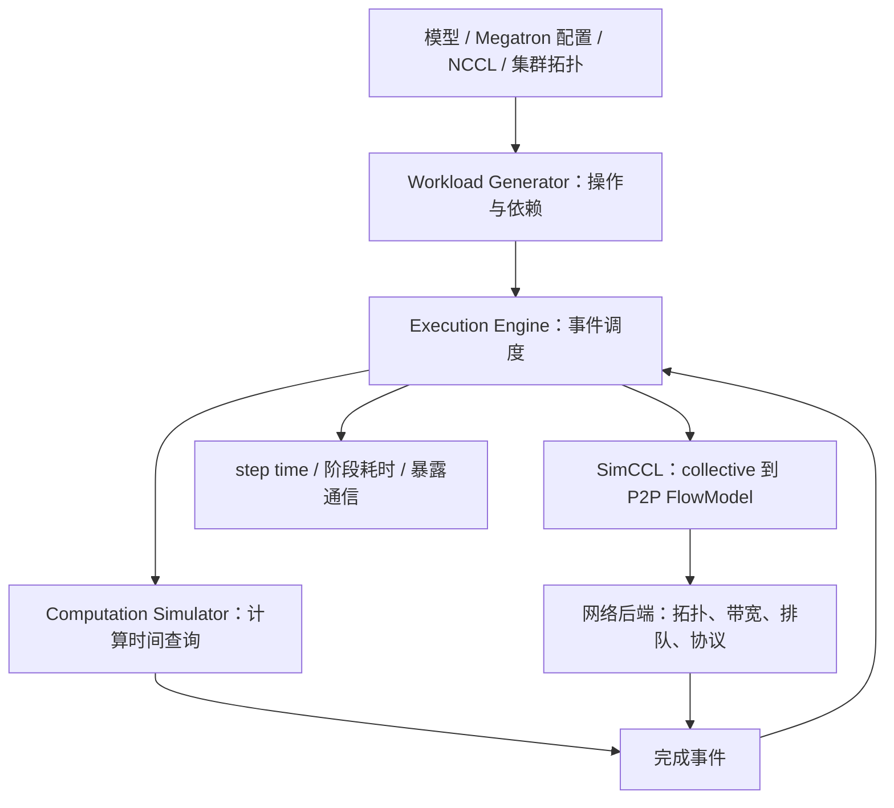

# SimAI（NSDI 2025）：设计思想、实现机制与 Megatron-LM 工程落地

> [!warning]
> 本文为 AI 辅助论文与源码调研，尚未完成人工核验。本文区分**论文结果**、**固定版本源码事实**、**基于机制的推导**与**待实施方案**。没有在本次整理中执行 SimAI/Megatron 的端到端性能验证。

**论文**：Xizheng Wang et al., *SimAI: Unifying Architecture Design and Performance Tuning for Large-Scale Large Language Model Training with Scalability and Precision*, NSDI '25, pp. 541–558。  
**研究日期**：2026-11-11。  
**原文入口**：[USENIX 论文 PDF](https://www.usenix.org/system/files/nsdi25-wang-xizheng-simai.pdf) · [论文页面](https://www.usenix.org/conference/nsdi25/presentation/wang-xizheng-simai) · [[30_Sources/SimAI-NSDI25/README|按页码中英对照精读]]。  
**相关工程研究**：[[SimAI 技术架构与 Megatron-LM 训练性能仿真方案]]（模块可替换性、SimuMax 对比、Megatron Core 适配设计，本文不重复全面展开）。

## 0. 核心结论

SimAI 的主要贡献是**把训练框架的执行语义、计算代价、collective 分解以及网络传输放入统一的离散事件时间线**。它保留决定性能的软件行为，以测量数据库和网络仿真代替昂贵的真实 GPU 执行，从而同时支持训练性能预测、硬件架构设计和通信调优。[论文 §3，PDF 第 4–8 页](https://www.usenix.org/system/files/nsdi25-wang-xizheng-simai.pdf#page=4)

核心设计可归结为四个工程选择：

1. **工作负载由训练框架驱动**：从模型与并行配置生成计算、通信和依赖，减少人工维护一份“近似 Megatron”的代价。
2. **计算采用实测优先、外推补充**：已有 GPU 使用按算子、形状和实现索引的时间数据库；未知 GPU 再使用计算/带宽约束模型。
3. **collective 复用 NCCL 决策信息**：从高级 AllReduce/AllGather/ReduceScatter 还原算法、channel、chunk 与 P2P 流，继而模拟拓扑和网络资源竞争。
4. **模拟器自身需要并行化**：通过多线程与按节点划分状态所有权，提高细粒度网络仿真的运行速度。

**针对 Megatron-LM 的判断**：SimAI 适合作为通信与网络仿真底座。第一阶段优先建立一个可与真实 Megatron trace 逐事件对照的 dense workload；再补足 backward/overlap、recompute、CP、MoE 与 VLM。当前开源生成器可以帮助跑通输入格式，但不应直接继承 NSDI '25 的端到端精度数字。

## 1. 数学符号表

| 符号 | 定义 | 单位 / 范围 |
| --- | --- | --- |
| $T_{\mathrm{step}}$ | 一次训练迭代的完成时间 | s / ms |
| $T_{\mathrm{real}}$、$\hat T$ | 实测与模拟的迭代时间 | s / ms |
| $t_v$ | 事件 $v$ 的执行/等待时长 | s / ms |
| $t_{\mathrm{comp}}$、$t_{\mathrm{comm}}$ | 计算与通信操作耗时 | s / ms |
| $t_{\mathrm{independent}}$ | 可与当前通信并行的独立计算窗口 | s / ms |
| $t_{\mathrm{exposed}}$ | 通信在关键路径上未被覆盖的时间 | s / ms |
| $G=(V,E)$ | 训练事件有向无环图（抽象模型） | 图 |
| $V$、$E$ | 事件集合与 happens-before 依赖边集合 | 集合 |
| $\mathcal P$、$p$ | 从起点到终点的依赖路径集合及其中一条路径 | 路径 |
| $T_{\mathrm{critical}}$ | 不考虑资源冲突时的关键路径下界 | s / ms |
| $F$、$Q$ | 单个操作的 FLOPs 与内存访问字节数 | FLOP / byte |
| $P_{\mathrm{eff}}$、$B_{\mathrm{eff}}$ | 有效计算吞吐与有效内存带宽 | FLOP/s / byte/s |
| $t_{\mathrm{known}}$、$t_{\mathrm{new}}$ | 已知设备和待估设备上同一工作量的耗时 | s / ms |
| $S$、$n$ | collective 参与者视角的消息大小与 rank 数 | byte / 个 |
| $B_{\mathrm{alg}}$、$B_{\mathrm{bus}}$ | NCCL tests 算法带宽与 bus bandwidth | byte/s |
| $\epsilon_i$ | 第 $i$ 个测试场景的绝对相对误差 | 无量纲 |

后文涉及的 TP、PP、DP、EP、CP、SP 分别表示张量、流水线、数据、专家、上下文和序列并行。工作负载字段中的单位以对应版本的接口为准。

## 2. 系统心智模型：性能是一条受依赖约束的时间线

### 2.1 从配置到结果的数据流



每一层回答不同的问题。模型与训练框架决定**要执行哪些操作以及它们何时具备启动条件**；计算模型决定操作占用多长时间；SimCCL 决定高层 collective 变成什么通信流；网络后端决定这些流何时到达。完成事件反过来决定训练是否继续。

这解释了 SimCCL 与 ns-3 的关系：**SimCCL 是 collective-to-flow 转换层，ns-3 是完整 Simulation 路径中的网络模拟后端；二者顺序连接，不是同一接口下的二选一执行引擎。** 当前 [SimAI README 的组件组合表](https://github.com/aliyun/SimAI/blob/a57d765c5478f319c5f5ab6fdc53f9cc7f461743/README.md)明确区分 Analytical 与 Simulation。历史 ASTRA-sim 代码承担工作负载事件与网络接口衔接。

### 2.2 为什么简单求和会失真

以一次 TP backward 局部执行为例：输入梯度计算 2 ms，之后的通信 4 ms，独立权重梯度计算 6 ms。在没有资源相互干扰且允许完全重叠的前提下，执行时间是：

$$
T=2+\max(4,6)=8\ \mathrm{ms}.
$$

简单求和会得到 12 ms。即使将网络通信缩短到 2 ms，这一局部片段仍需 8 ms。网络变快未必提高 step throughput，因为通信可能本来就不在关键路径上。

在一个计算窗口与一次通信的简化模型中：

$$
t_{\mathrm{exposed}}
=\max\left(0,t_{\mathrm{comm}}-t_{\mathrm{independent}}\right).
$$

推广到不考虑资源冲突的依赖 DAG，可得到完成时间下界：

$$
T_{\mathrm{critical}}
=\max_{p\in\mathcal P}\ \sum_{v\in p}t_v.
$$

真实仿真还要考虑 GPU kernel、copy engine、NIC、网络链路和队列对同一资源的争用。因此，**仅有事件 DAG 和操作时长仍不足以精确预测并发情况；资源调度必须与依赖同时进入模型**。[论文 Figure 2，PDF 第 5 页](https://www.usenix.org/system/files/nsdi25-wang-xizheng-simai.pdf#page=5)

### 2.3 设计取舍：模拟“时间相关行为”，不做数值执行

SimAI 的直接应用是容量规划、并行配置搜索、CCL/网络优化和硬件 co-design。它的输入通常是抽象工作负载和统计计算成本，故训练数值、收敛性与 RL reward 等结果需要由其他实验评估。对 MoE、动态序列以及 RL 后训练这种依赖输入值的执行路径，应额外注入 token 分布、请求长度和真实调度轨迹，而不能只通过参数量替代。

## 3. 设计一：由训练框架产生工作负载

### 3.1 为什么选择 mock/hijack，而不是手写 FLOPs 表

论文 §3.2 和 `6 描述了从手写框架模拟逐步转向利用真实框架关键路径的演化。模型规模、TP/PP/DP、参数分片和优化器设置会改变 local tensor shape、collective 类型、执行次序及等待点。单靠模型参数和 FLOPs 公式无法稳定维护这些关系。[论文 §3.2 和 `6](https://www.usenix.org/system/files/nsdi25-wang-xizheng-simai.pdf#page=4)

工作负载至少需要包含：

| 字段 | 目的 | 必须校验的细节 |
| --- | --- | --- |
| `op` 与 `phase` | forward / input-grad / weight-grad / optimizer 的语义 | backward 的两个阶段是否分开 |
| `rank_group` | TP/DP/PP/EP/CP 的通信范围 | rank membership 与 topology mapping |
| `bytes` 与 `collective` | 通信量与类别 | 单 rank payload、dtype、buffer 大小 |
| `dependencies` | 何时可运行、何时必须等待 | 非阻塞通信、bucket readiness、pipeline 顺序 |
| `compute_key` | 计算时间数据库的索引 | shape、kernel、dtype、软件版本 |
| `stream/resource` | 同时执行是否争用硬件 | compute/copy/通信资源 |
| `repeat/microbatch` | 训练 step 的重复结构 | PP schedule、梯度累积 |
| `source` | 事实来源 | 采集 trace / 框架推导 / 假设 |

**设计建议**：生成一个框架无关的 Canonical Workload IR；保留每个事件的证据来源，后端再翻译为现有 SimAI 格式。这样可以单独测试 workload 的正确性，而不需要每次启动完整 ns-3。

### 3.2 当前 AICB 已实现的是什么

当前 AICB 的训练路径包含 `MockedMegatron` / `MockedDeepSeek`、AIOB 时间采样以及 workload 序列化，工作负载通过 `SimAI_training_workload_generator.py` 写出。[AICB generator](https://github.com/aliyun/aicb/blob/23eec3c48ca2d2d93dd888a4c7b22ab4421e782f/workload_generator/SimAI_training_workload_generator.py) · [AiobMegatron](https://github.com/aliyun/aicb/blob/23eec3c48ca2d2d93dd888a4c7b22ab4421e782f/workload_generator/mocked_model/training/AiobMegatron.py)

工程上，**模型结构的近似支持与当前 Megatron Core 执行语义一致是两级不同的能力**。AICB 能生成一条工作负载，不意味着它准确反映目标版本的 gradient bucket、pipeline interleaving、CP Attention、EP router 与 selective recompute。

已核对的源码还显示：现有 generator 的头部写出 `checkpoints: 0 checkpoint_initiates: 0`；与之对应，ASTRA 执行引擎保留 `Forward_In_BackPass` 状态机。前端和后端的能力需要对接后，recompute 才会成为完整事件序列。[AICB 输出头](https://github.com/aliyun/aicb/blob/23eec3c48ca2d2d93dd888a4c7b22ab4421e782f/workload_generator/SimAI_training_workload_generator.py#L841-L870) · [Workload 状态机](https://github.com/aliyun/SimAI/blob/a57d765c5478f319c5f5ab6fdc53f9cc7f461743/astra-sim-alibabacloud/astra-sim/workload/Workload.cc)

## 4. 设计二：测量优先的计算模型

### 4.1 已有 GPU：用真实 kernel/子模块时间作为成本

论文 §3.3 的 SimAI-CP 采用操作时间数据库，必要时从 submodule 细化到 kernel 粒度。这样可以吸收算子实现、实际 GPU 利用率和编译/库差异，避免模拟每条 GPU 指令的高成本。[论文 Table 4，PDF 第 6 页](https://www.usenix.org/system/files/nsdi25-wang-xizheng-simai.pdf#page=6)

推荐最小数据库键：

`(GPU, dtype, op, phase, local_shape, layout, kernel_impl, library_version, math_mode)`。

记录还应包含 warmup、采样次数、P50/P95 与测量条件。改变 TP 会同时改变 local shape 和算子效率；把一个 GEMM 时间简单按 FLOPs 线性缩放，可能错过 Tensor Core tile、launch overhead、fusion、occupancy 的跃迁。

在固定操作量 $F$、内存访问量 $Q$ 下，近似时间受两种资源下界约束：

$$
t \gtrsim \max\left(\frac{F}{P_{\mathrm{eff}}},\frac{Q}{B_{\mathrm{eff}}}\right).
$$

这是一个性能分析下界，真实 kernel 还可能受到调度、同步和访存相关性影响。

### 4.2 未上市 GPU：区分外推与实测可信度

论文 SimAI-CP-Model 使用计算受限、内存带宽受限两类 kernel 模型。固定工作量且瓶颈类型与效率近似不变时，正确的单调性应是：

$$
t_{\mathrm{new,comp}}
\approx t_{\mathrm{known}}
\frac{P_{\mathrm{eff,known}}}{P_{\mathrm{eff,new}}},
\qquad
t_{\mathrm{new,mem}}
\approx t_{\mathrm{known}}
\frac{B_{\mathrm{eff,known}}}{B_{\mathrm{eff,new}}}.
$$

论文 §3.3 p.546 所呈现的外推比例为 `new/known × known_time`，与固定工作量的物理反比关系相冲突。本报告给出上述**推导后的工程校验公式**；引用原论文公式时应注明这个疑点，作者勘误状态未核实。[论文 p.546，PDF 第 7 页](https://www.usenix.org/system/files/nsdi25-wang-xizheng-simai.pdf#page=7)

原论文 §4.3 的比较也说明了两条路径不能混用：**SimAI-CP 实测时间库的总计算时间偏差为 0.5%–3.1%，SimAI-CP-Model 外推为 13%–15%**（该论文的模型、算子、硬件与测试条件）。[论文 §4.3](https://www.usenix.org/system/files/nsdi25-wang-xizheng-simai.pdf#page=9)

### 4.3 当前 AIOB 的反向采样近似

当前 AIOB 在读取部分 Attention/MLP 前向计时时存在：

```python
attention_backward = attention_forward
mlp_backward = mlp_forward
```

同时，generator 在某些路径中把 forward/IG/WG 分别映射到 `forward_compute_time`、`backward_compute_time`、`dp_compute_time`。因此该路径中的 backward 时间是根据前向测量构造的近似，而非独立采集的完整 backward kernel profile。[AIOB `extract_averages()`](https://github.com/aliyun/aicb/blob/23eec3c48ca2d2d93dd888a4c7b22ab4421e782f/utils/utils.py) · [训练 workload](https://github.com/aliyun/aicb/blob/23eec3c48ca2d2d93dd888a4c7b22ab4421e782f/workload_generator/SimAI_training_workload_generator.py)

**落地措施**：对真实 Megatron 中使用的 Attention、MLP、LayerNorm、Grouped GEMM、embedding、loss 和 optimizer，独立测量 forward/dgrad/wgrad，并在计算数据库中保留 fused 与 unfused 的版本。

## 5. 设计三：复用 NCCL 通信决策，再交给网络模拟

### 5.1 为什么高级 collective 不够

一个 AllReduce 的消息大小和 rank 数确定之后，仍需确定 Ring/Tree/NVLS/PAT 等算法、LL/LL128/Simple 协议、channel 数、chunk 划分和连接路径。即使通信总字节相同，flow 的启动/完成关系和网络热点也可能不同。

论文 Figure 3 的核心链路是：

```text
Collective(type, group, bytes)
      -> SimCCL 虚拟 communicator / topology / algorithm
      -> channel、chunk 与 P2P flow DAG
      -> SimAI Execution Engine
      -> ns-3：发送、排队、链路竞争、完成回调
```

SimCCL 可以表示 PXN 之类的中继路径。例如，逻辑 1→8 的传输在中间节点 0 转发时，可被表达为 1→0 与 0→8 两段；这改变了节点内与跨节点资源占用。[论文 §3.4 / Figure 3](https://www.usenix.org/system/files/nsdi25-wang-xizheng-simai.pdf#page=7)

### 5.2 历史算法选择逻辑与当前默认实现的区别

阅读当前 SimAI 时必须固定版本。历史 `SimCCL/src/enqueue.cc::topoGetAlgoInfo()` 遍历算法与协议并调用 `ncclTopoGetAlgoTime()`，体现了重用 NCCL 调优逻辑的设计。[历史版本实现](https://github.com/aliyun/SimAI/blob/49b226108ae3a6dc3de3761f6d535d9f8de1abe5/SimCCL/src/enqueue.cc)

当前独立 SimCCL 绑定版本的 `MockNcclGroup::get_algo_proto_info()` 对部分 TP collective 的算法和协议使用 GPU 类型、rank 布局和消息阈值。它包含 NVLS/PAT 选择和协议分段逻辑。**因此，在目标集群校准前，应先比对实际 NCCL 与模拟器的 algorithm/protocol/channel/flow，然后再比较耗时。**[当前实现](https://github.com/aliyun/SimCCL/blob/fd7cd57d16f9bd42e3ccb70911c977e18ec294b9/src/mock/v2.30/MockNcclGroup.cc)

当前网络接口 `SendFlow()` 对不同算法/协议和跨节点/节点内链接使用延迟表，并支持 `AS_SEND_LAT` 覆盖。这类校准配置需要与具体 GPU/NCCL 拓扑一起版本化。[网络发送实现](https://github.com/aliyun/SimAI/blob/a57d765c5478f319c5f5ab6fdc53f9cc7f461743/astra-sim-alibabacloud/astra-sim/network_frontend/ns3/entry.h)

### 5.3 带宽口径必须统一

NCCL tests 对 AllReduce 的常用定义为：

$$
B_{\mathrm{alg}}=\frac{S}{t_{\mathrm{comm}}},
\qquad
B_{\mathrm{bus}}=B_{\mathrm{alg}}\frac{2(n-1)}{n}.
$$

其中 $S$ 是 NCCL tests 相应测试的 rank 消息大小，$n$ 是 collective rank 数；其他 collective 的 bus bandwidth 系数不同。**busbw 不等于线速，也不能无条件替代单 GPU 实际 payload 吞吐。** 参考 [NVIDIA nccl-tests 的性能口径](https://github.com/NVIDIA/nccl-tests/blob/master/doc/PERFORMANCE.md)。

### 5.4 两级模拟路径的取舍

| 模式 | 模拟成本 | 适合的决策 |
| --- | --- | --- |
| SimAI-Analytical | 较低，用带宽/统计时间近似 | 大规模配置初筛、灵敏度分析 |
| SimAI-Simulation | 较高，collective flow + 网络细节 | 网络拓扑、拥塞、algorithm、rail 与重叠分析 |
| SimCCL standalone | 仅分析 collective 分解 | 验证算法、协议和 FlowModel 输入正确性 |

当前 README 的 `-busbw` 手动 YAML 选项没有接入最新公开 Analytical binary；运行参数应按绑定的源码和教程检查。[SimAI 当前 README](https://github.com/aliyun/SimAI/blob/a57d765c5478f319c5f5ab6fdc53f9cc7f461743/README.md)

## 6. 设计四：用状态所有权提升细粒度模拟速度

模拟一轮 128 GPU 训练若需要一天，准确率再高也无法支撑大范围配置搜索。论文在 §3.5 中采用 UNISON 多线程并行网络仿真，并通过按模拟节点归属拆分全局状态，减少全局锁与原子操作上的争用。

论文报告：改造后的模拟程序相对单线程版本加速 **23×**，相对原先多线程实现再改善约 **15%**。这里提升的是**仿真器 wall-clock 运行速度**，与被模拟的训练吞吐是两个指标。[论文 §3.5](https://www.usenix.org/system/files/nsdi25-wang-xizheng-simai.pdf#page=8)

工程启示是先解决状态所有权。对每个 thread/模拟节点，明确发送字节数、交换机队列、TX/RX QP 等信息由谁写入，尽量局部化。实现新网络协议后，既测预测误差，也测 simulation wall time、峰值内存和吞吐随线程数的扩展曲线。

## 7. 论文实验证据：说明了哪些能力

论文 §4 以真实 A100/H100 集群为对照，覆盖 128、512 和 1024 GPU；展示 GPT-3 13B、LLaMA 65B、GPT-3 175B 等代表性 workload。采用了匹配的模型、框架、网络拓扑与 NCCL 参数，ASTRA-sim 比较还使用 SimAI-WG 的 workload adapter。[论文 §4，PDF 第 8–10 页](https://www.usenix.org/system/files/nsdi25-wang-xizheng-simai.pdf#page=8)

| 指标 | 论文报告 | 解释范围 |
| --- | --- | --- |
| 端到端平均 alignment | 98.1%，即平均偏差约 1.9% | 论文的测试集与统计口径 |
| E2E 最大偏差 | 论文展示场景低于 3.9% | 不是任意框架与 GPU 的误差上界 |
| 相对 ASTRA-sim | 36.1× 误差改善 | 对论文所选 ASTRA-sim 比较基线 |
| 实测计算数据库 | 总计算时间偏差 0.5%–3.1% | SimAI-CP |
| 跨 GPU 计算外推 | 总计算时间偏差 13%–15% | SimAI-CP-Model |
| 仿真器运行加速 | 23× | 对单线程版本，非训练加速 |

论文 §5 提供了两个更有工程价值的案例：

**网络带宽投资**：在论文的 1024 H100 GPU 设计场景中，从每 GPU 200 Gbps 提高到 400 Gbps，模拟显示约 **19%** 的训练性能提升；H20 从 100→200 Gbps 约 **11%**，200→400 Gbps 约 **6%**。这说明网络边际收益取决于整个训练关键路径，而非 GPU 峰值 FLOPS 比例。[论文 Figure 10](https://www.usenix.org/system/files/nsdi25-wang-xizheng-simai.pdf#page=10)

**TP 选择**：论文在 8/16/32/64 GPU 单节点设计中比较 TP，给出不同模型不同最优点。其意义在于把计算并行收益与集合通信增长放进同一优化目标；最优 TP 依赖模型和网络配置。[论文 Figure 11](https://www.usenix.org/system/files/nsdi25-wang-xizheng-simai.pdf#page=11)

落地时建议同时比较**单点误差、阶段误差和方案排序**。即使总 step time 很接近真值，计算低估与通信高估也可能相互抵消。如果预测无法正确排序 TP4/TP8 或两种 NIC 配置，模型对调优仍不可靠。

相对误差定义为：

$$
\epsilon_i=\frac{|\hat T_i-T_{\mathrm{real},i}|}{T_{\mathrm{real},i}}.
$$

报告平均误差时应公开样本集合、权重、真实训练波动和计算方式。

## 8. 固定版本源码核验矩阵（2026-11-11）

以下属于**本次所列快照的代码事实**，与论文 2025 年方案分开阅读。

| 组件 | 固定 commit | 核验入口 |
| --- | --- | --- |
| SimAI / ASTRA 前端 | [`a57d765c5478`](https://github.com/aliyun/SimAI/tree/a57d765c5478f319c5f5ab6fdc53f9cc7f461743) | `Workload.cc`、`Layer.cc`、`entry.h` |
| AICB | [`23eec3c48ca2`](https://github.com/aliyun/aicb/tree/23eec3c48ca2d2d93dd888a4c7b22ab4421e782f) | `AiobMegatron.py`、`SimAI_training_workload_generator.py` |
| SimCCL | [`fd7cd57d16f9`](https://github.com/aliyun/SimCCL/tree/fd7cd57d16f9bd42e3ccb70911c977e18ec294b9) | `MockNcclGroup.cc` |
| ns-3-alibabacloud | [`3e0c7c1bfbbe`](https://github.com/aliyun/ns-3-alibabacloud/tree/3e0c7c1bfbbe9f77890ddcf5e5b9c79fc6dd7437) | 网络仿真后端 |

| 问题 | 已核对的机制或缺口 | 工程后果 |
| --- | --- | --- |
| Backward 耗时 | AIOB 部分路径以 forward 估算 backward | kernel 级误差会进入通信重叠窗口 |
| Recompute | AICB 在不同路径里有倍率近似；执行引擎具有重放状态；workload 头默认为 0 | 需验证真实重放范围、时机、通信与激活生命周期 |
| Overlap | Simulation 有阻塞/非阻塞依赖；Analytical 对 TP/DP/EP 使用 overlap ratio | 两种模式不能直接等同 |
| PP | workload 包含聚合 PP 描述，当前引擎使用特定调度结构 | 需覆盖 Megatron 的真实 microbatch / VPP 时序 |
| MoE | 当前 AIOB 的 `tokens_per_expert` 为均衡构造值，路由/重排路径有注释掉的实现 | 真实路由倾斜、跨 rank 不均衡未获得对应测量 |
| CP | 有参数接口，但旧 producer 和格式未全面表达 CP group/Attention 通信 | 长序列 CP 要新建 workload 适配 |
| SimCCL | 默认部分 collective 使用阈值/规则选择算法与协议 | 目标 NCCL 版本需要算法级校准 |
| 网络延迟 | 有按协议和路径分桶的延迟表 | 需要记录版本与来源，不宜与线速公式混用 |

主要定位：[AICB MoE `tokens_per_expert`](https://github.com/aliyun/aicb/blob/23eec3c48ca2d2d93dd888a4c7b22ab4421e782f/workload_generator/mocked_model/training/AiobMegatron.py#L1068-L1107) · [AICB recompute 分支](https://github.com/aliyun/aicb/blob/23eec3c48ca2d2d93dd888a4c7b22ab4421e782f/workload_generator/SimAI_training_workload_generator.py#L480-L540) · [引擎重放和异步状态](https://github.com/aliyun/SimAI/blob/a57d765c5478f319c5f5ab6fdc53f9cc7f461743/astra-sim-alibabacloud/astra-sim/workload/Workload.cc#L793-L929) · [Analytical overlap](https://github.com/aliyun/SimAI/blob/a57d765c5478f319c5f5ab6fdc53f9cc7f461743/astra-sim-alibabacloud/astra-sim/workload/Layer.cc#L575-L625)。

## 9. 面向 Megatron-LM 的分阶段实施方案

### Phase 0：锁定版本与重现一条官方 workload

**目标**：确认 SimAI-Analytical、Simulation 和 SimCCL standalone 在固定版本下可运行；输出耗时和日志。记录精确 Git SHA、GPU/NCCL/CUDA 版本、CPU、拓扑及各时间字段单位。每一次比较都保留输入 workload 与结果文件。

**验收**：相同输入重复执行输出一致；结果字段单位明确；能定位至少一次 collective 的算法与 FlowModel。此阶段只验“工具链跑通”，不评价训练预测精度。

### Phase 1：构造可审计的 dense Megatron workload

选择 Qwen3 类标准 dense Transformer 或更小的 GPT/LLaMA 基线，先使用 PP1、CP1、EP1。实现 **MCore Trace → Canonical Workload IR → SimAI workload** 的单向转换，明确 local shape、算子时间、TP/SP/DP 通信与依赖。

**验收**：对单次真实训练运行，用 torch profiler / NCCL 日志逐事件检查 operator phase、rank group、消息字节数和关键 happens-before 关系；统计缺失事件、重复事件与错误字节数。先确保结构正确，再比较 step time。

### Phase 2：计算/collective 校准

建立真实 GPU 操作计时库，至少拆出 forward、dgrad、wgrad；通过 nccl-tests 和真实 NCCL DEBUG trace 扫描 collectives、消息大小、TP/DP group、单机/跨机网络拓扑，核对算法与协议选择。

**验收**：发布计算、通信各自的误差分布以及整步误差；留出未参与拟合的 shape 和消息大小做验证。以“10% → 5%”作为可调整的内部 E2E 目标，而非论文已证指标。

### Phase 3：通信重叠与 PP/VPP

逐项加入 DP gradient reduce-scatter / parameter all-gather、TP sequence parallel、async grad communication、microbatch 与 interleaved PP。记录 compute 和 communicator 的 ready time、start time、finish time。

**验收**：能够解释“通信加速但 step time 不变”的案例，并预测修改 overlap/PP schedule 前后的实际时间差和排序。

### Phase 4：Recompute + 激活/显存约束

用显式重放事件描述 full/selective activation recomputation，保留重放的 forward kernel、通信与 backward 中发生的确切时机；同时跟踪激活生存区间、保留/释放和峰值显存。recompute 策略必须与 Megatron 实际 API 和模型实现逐项映射。

**验收**：关闭/开启 recompute 的计算事件增量、通信数量、step time 与训练峰值显存变化都可在小规模真机对照。仅增加 forward 时间倍率不能通过本阶段。

### Phase 5：MoE、CP、128K 与 VLM/RL 后训练

MoE 增加 expert token histogram、dispatch/combine AllToAll、grouped GEMM shape 和最慢 rank；CP 增加上下文划分下 Attention 通信与算子交错；VLM 增加 ViT/projector 和输入动态长度分布；RL 增加 rollout/actor 侧相关执行阶段、packing 和额外 logprob forward。

**验收**：对不同 token 长度、vision-token 比例、expert skew、CP degree 做留出测试；报告绝对误差、分阶段误差和方案排序正确性。RL reward/收敛不属于这个时间模拟器的验收范围。

### Phase 6：架构与并行策略搜索

使用 Analytical 扫描大量 TP/PP/DP/CP/EP、recompute、网络带宽与节点拓扑候选，再用 Simulation 精化小量候选。对每个候选保存配置、预测瓶颈、关键路径、预期收益、资源约束和校准覆盖范围。

**验收**：至少在若干未用于校准的候选上，真实训练验证“最佳方案”及收益区间；不能仅凭原配置误差小就宣称搜索有效。

## 10. 本报告的直接工程建议

**优先级 1：统一 workload 语义。** 这是所有后端共享的输入，也是当前 AICB 与 Megatron Core 语义差异最大的部分。建议维护 `event_id / source / phase / rank_group / bytes / deps / compute_key / stream` 等强类型字段，并生成事件差异报告。

**优先级 2：把计算和通信校准分开。** 数据库中的“实测”“估算”“占位”“外推”标记必须随事件进入最终报告。真实 NCCL 与 SimCCL 的算法不一致时，先解决算法差异，再调整时间参数。

**优先级 3：保留关键路径与暴露时间。** 只输出 total compute/comm 和 step time，难以知道优化结果。应将 exposed TP/DP/EP/CP comm、pipeline bubble、checkpoint replay、NIC busy time 和 simulator wall time 分别输出。

**优先级 4：做留出场景验收。** 将配置分为校准集与验证集。对“预测收益排序”和“特定瓶颈定位”建立指标，这比持续调参直到一个 step time 接近真值更能支持最终的集群架构决策。

### 已知研究边界与后续核验

- 本次资料核验以列出的固定源码快照和论文为准；软件更新后需重新核对。
- 本报告没有实际运行 SimAI + Megatron 的 E2E 实验。CPU 构造样例只能验证代码分支，不能作为训练性能证据。
- 原论文 CP-Model 的两个比值公式存在单调性疑点；实际采用的缩放公式应做独立物理检查。
- 需要后续落实的实验：反向三阶段计时、重计算事件数量、CP/EP 事件覆盖、真实 NCCL 选型和模拟器并发资源约束。

## 11. References / 阅读导航

1. **论文**：Wang et al., *SimAI*, NSDI '25, pp. 541–558。 [官方 PDF](https://www.usenix.org/system/files/nsdi25-wang-xizheng-simai.pdf) · [USENIX 页面](https://www.usenix.org/conference/nsdi25/presentation/wang-xizheng-simai)。
2. **原文逐页精读**：[[30_Sources/SimAI-NSDI25/README|SimAI（NSDI 2025）中英文对照精读]]，含 Figure 1–11、Table 1–5 的 PDF 定位。
3. **SimAI 开源**：[aliyun/SimAI](https://github.com/aliyun/SimAI)；[AICB](https://github.com/aliyun/aicb)；[SimCCL](https://github.com/aliyun/SimCCL)；[ns-3-alibabacloud](https://github.com/aliyun/ns-3-alibabacloud)。
4. **既有大型工程调研**：[[SimAI 技术架构与 Megatron-LM 训练性能仿真方案]]，包括 SimuMax 对照、Canonical IR 草案和 Megatron Core 0.20 适配阶段。
5. **NCCL 性能术语**：[nccl-tests PERFORMANCE](https://github.com/NVIDIA/nccl-tests/blob/master/doc/PERFORMANCE.md)。
6. **训练重计算参考**：[Megatron Bridge Activation Recomputation](https://docs.nvidia.com/nemo/megatron-bridge/latest/training/activation-recomputation.html)。
7. **写作规范**：[Kiterlin/anti-defensive-writing](https://github.com/Kiterlin/anti-defensive-writing/blob/main/SKILL.md)，采用“直接陈述发现、保留必要方法边界”的原则。
